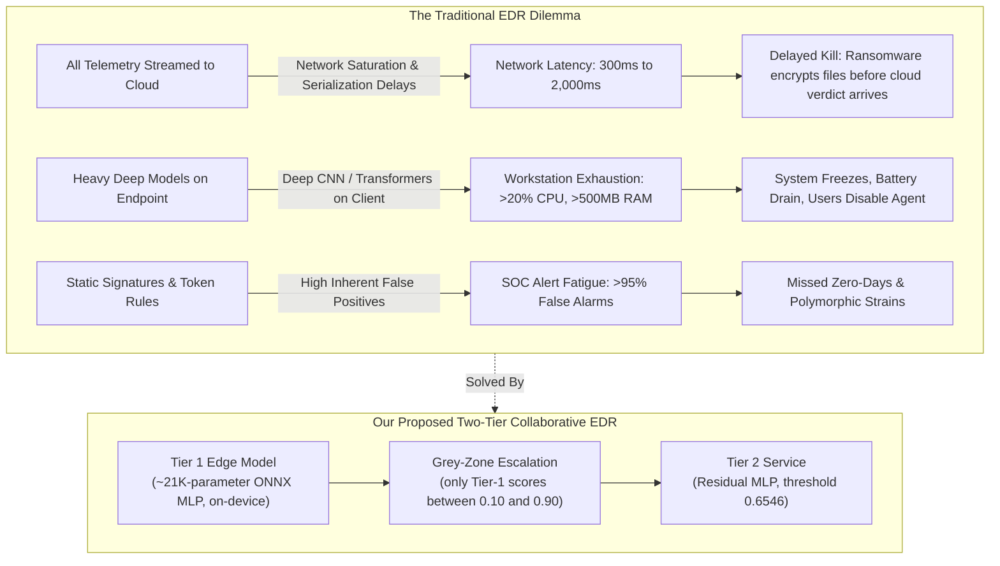
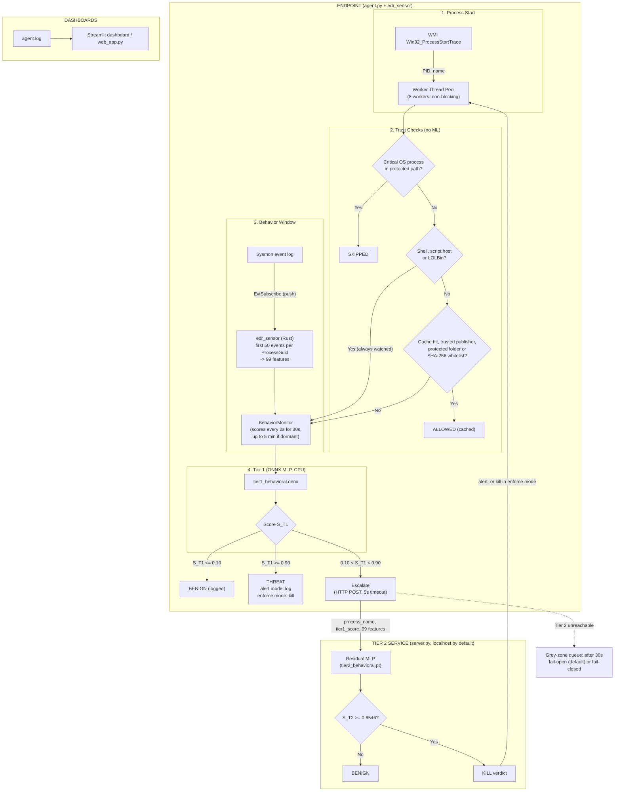
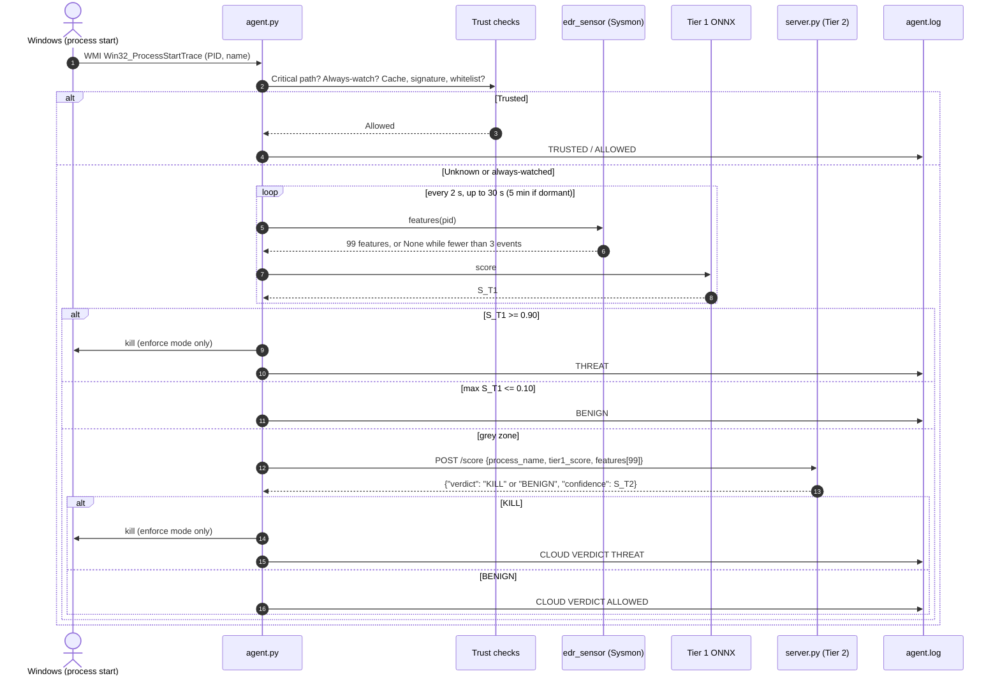
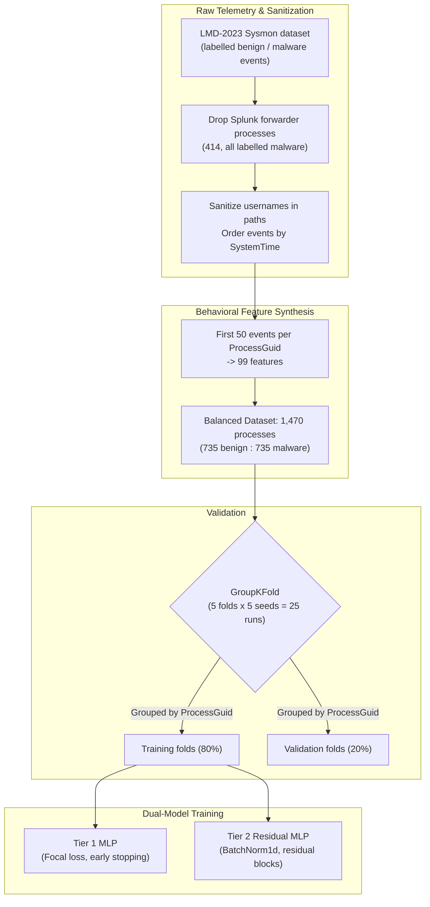
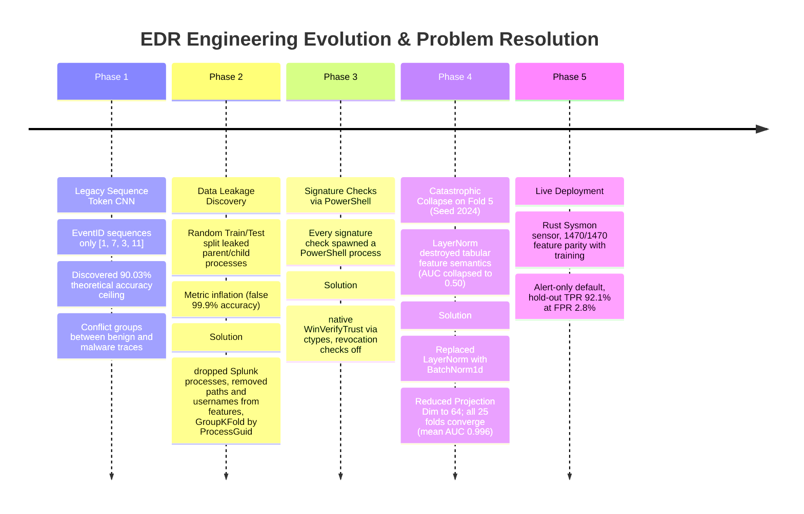
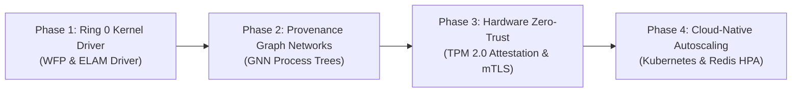

# Telltale

**Behavioral ransomware detection for Windows.** Telltale catches ransomware by what it does,
not what it's called: every new process is judged on the behavior that gives it away.

*Research title: Behavioral Cyber-Resilient Detection Framework for Early Detection of Ransomware Attacks*

[](#3-system-architecture)
[](#14-installation--quickstart)
[](#hold-out-results-honest-baseline)
[](#hold-out-results-honest-baseline)
[](#14-installation--quickstart)
[](https://www.python.org/)
[](LICENSE)

A **two-tier behavioral EDR** for Windows. The agent watches each new, untrusted process through
Sysmon, turns its first 50 events into 99 behavioral features, and scores them with a small
on-device MLP (ONNX). Clear cases are decided on the endpoint; ambiguous "grey-zone" scores go
to a second model behind a FastAPI service.

The design keeps clear-cut decisions on the endpoint (no network round trip), keeps the endpoint
model cheap, and sends only ambiguous cases to Tier 2. Read the
[hold-out results](#hold-out-results-honest-baseline) before relying on any number here: on 294
unseen processes the two-tier pipeline caught 92.1% of malware at a 2.8% false-positive rate.

---

## Table of Contents

- [1. Executive Summary](#1-executive-summary)
- [2. The Fundamental Problem: The Legacy EDR Trilemma](#2-the-fundamental-problem-the-legacy-edr-trilemma)
- [3. System Architecture](#3-system-architecture)
  - [3.1 High-Level Architecture Diagram](#31-high-level-architecture-diagram)
  - [3.2 End-to-End Telemetry & Remediation Flow](#32-end-to-end-telemetry--remediation-flow)
- [4. Process Lifecycle & Scoring Mechanics](#4-process-lifecycle--scoring-mechanics)
  - [4.1 Multi-Stage Gating Protocol](#41-multi-stage-gating-protocol)
  - [4.2 Process Lifecycle Sequence Flowchart](#42-process-lifecycle-sequence-flowchart)
- [5. Feature Engineering: 99 Behavioral Structural Invariants](#5-feature-engineering-99-behavioral-structural-invariants)
  - [5.1 Why Sequential Token Models Fail (The 90% Ceiling Proof)](#51-why-sequential-token-models-fail-the-90-ceiling-proof)
  - [5.2 Behavioral Feature Matrix (All 99 Features)](#52-behavioral-feature-matrix-all-99-features)
- [6. Model Design & Mathematical Justification](#6-model-design--mathematical-justification)
  - [6.1 Tier 1 Edge Model: Ultra-Lightweight Behavioral MLP (ONNX)](#61-tier-1-edge-model-ultra-lightweight-behavioral-mlp-onnx)
  - [6.2 Tier 2 Cloud Model: Deep Behavioral Residual Network (ResNet)](#62-tier-2-cloud-model-deep-behavioral-residual-network-resnet)
  - [6.3 Loss Function & Operating Threshold Derivation ($\Theta = 0.6546$)](#63-loss-function--operating-threshold-derivation-theta--06546)
- [7. Empirical Benchmarks & Scientific Rigor](#7-empirical-benchmarks--scientific-rigor)
  - [7.1 Preventing Data Leakage via Strict 5-Seed GroupKFold](#71-preventing-data-leakage-via-strict-5-seed-groupkfold)
  - [7.2 Benchmark Performance Matrix](#72-benchmark-performance-matrix)
  - [7.3 Hardware Feasibility & Edge Footprint](#73-hardware-feasibility--edge-footprint)
- [8. Engineering Evolution: Real-World Hurdles & Applied Solutions](#8-engineering-evolution-real-world-hurdles--applied-solutions)
  - [8.1 Evolution Timeline](#81-evolution-timeline)
  - [8.2 Problem 1: Signature Checks That Spawned PowerShell](#82-problem-1-signature-checks-that-spawned-powershell)
  - [8.3 Problem 2: ProcessGuid Data Leakage Trap](#83-problem-2-processguid-data-leakage-trap)
  - [8.4 Problem 3: Catastrophic Collapse on Fold 5 (Seed 2024)](#84-problem-3-catastrophic-collapse-on-fold-5-seed-2024)
- [9. Explainable AI (XAI) & Analyst Cockpit](#9-explainable-ai-xai--analyst-cockpit)
- [10. Unified SOC Command Center & User Interfaces](#10-unified-soc-command-center--user-interfaces)
- [11. Work Completed & Technical Deliverables](#11-work-completed--technical-deliverables)
- [12. Identified Gaps, Limitations & Threat Boundary](#12-identified-gaps-limitations--threat-boundary)
- [13. Future Roadmap & Next Milestones](#13-future-roadmap--next-milestones)
- [14. Installation & Quickstart](#14-installation--quickstart)
- [15. Repository Structure](#15-repository-structure)

---

## 1. Executive Summary

Fast-encrypting ransomware (e.g., LockBit 3.0, BlackCat) and living-off-the-land intrusions can
do real damage within seconds of starting, so Telltale scores behavior on the endpoint instead of
waiting for a cloud round trip.

The pipeline:
1. **Trust checks first.** Critical OS processes in protected paths, binaries signed by an
   allow-listed publisher (native `WinVerifyTrust`), binaries in protected Windows folders and
   SHA-256-whitelisted tools are skipped, and results are cached by `(path, mtime, size)`.
   Abusable signed tools (shells, script hosts, LOLBins) are always monitored.
2. **Behavior window.** Every other process is watched through Sysmon. The Rust `edr_sensor`
   keeps each process's first 50 events and computes **99 behavioral features** from them,
   exactly as the training set was built.
3. **Tier 1 (endpoint).** A ~21K-parameter ONNX MLP scores the process every 2 s for up to 30 s
   (up to 5 min if it stays silent). Score $\le 0.10$ is benign, $\ge 0.90$ is a threat.
4. **Tier 2 (service).** Scores in between are POSTed to `server.py`, a residual MLP whose
   threshold ($0.6546$) was chosen for < 1% FPR in cross-validation.
5. **Alert by default.** Threats are logged; killing requires `--mode enforce`.

---

## 2. The Fundamental Problem: The Legacy EDR Trilemma

Enterprise Endpoint Detection & Response solutions currently face a three-way engineering conflict:



### The Breakdown:
1. **The Cloud Latency Gap (300ms – 2,000ms):** Streaming raw telemetry over wide-area networks introduces catastrophic delay. By the time a cloud server receives events, infers a verdict, and returns a kill signal, the Master File Table (MFT) is corrupted.
2. **The Edge Compute Ceiling:** Running heavy sequence models (LSTMs, Transformers) directly on user endpoints drains battery, causes input lag, and exceeds workstation memory budgets.
3. **Alert Fatigue & Token Brittleness:** On our dataset, a model that sees only the Sysmon EventID sequence cannot exceed ~90% accuracy, because benign tools and malware produce identical sequences (section 5.1).

---

## 3. System Architecture

### 3.1 High-Level Architecture Diagram



### 3.2 End-to-End Telemetry & Remediation Flow

1. **Process start:** WMI `Win32_ProcessStartTrace` reports the PID and name. A worker thread
   resolves the real exe path with `psutil`; nothing is suspended.
2. **Trust checks:**
   - A critical OS process name is skipped only if its exe really lives in System32, SysWOW64,
     WinSxS or `%SystemRoot%` (not their user-writable subfolders). A masquerading name is analyzed.
   - Shells, script hosts and LOLBins (`ALWAYS_WATCH`) are always monitored, signed or not.
   - Otherwise: fingerprint cache `(path, mtime_ns, size)` → `WinVerifyTrust` plus a publisher
     allow-list (exact `O=` match) → protected Windows folder (catalog-signed OS binaries) →
     SHA-256 lookup in `whitelist.db`.
3. **Behavior window:** the Rust sensor attributes Sysmon events by `ProcessGuid` and keeps each
   process's earliest 50 events plus its creation event. No vector exists until a process has
   3 events, so "no data" is never scored as benign.
4. **Tier 1:** every 2 s the current vector is scored; the verdict uses the highest score seen.
   The window ends at 30 s, or as soon as 50 events are buffered. Processes that exit mid-window,
   or before triage, still get a verdict from their buffered events.
5. **Escalation:** grey-zone processes are POSTed to `/score`. If Tier 2 is unreachable they wait
   in a queue; after 30 s `NETWORK_FAIL_POLICY` applies (`OPEN` by default: left running, logged).
6. **Tier 2:** returns `KILL` when $S_{T2} \ge 0.6546$, otherwise `BENIGN`. The agent alerts, or
   kills in enforce mode after checking the PID was not reused.

---

## 4. Process Lifecycle & Scoring Mechanics

### 4.1 Multi-Stage Gating Protocol

| Stage | Decision | Condition | Action |
|---|---|---|---|
| **Skip** | Critical OS process | Name in safelist **and** exe in a protected path | Skipped |
| **Watch** | `ALWAYS_WATCH` | Shell, script host or LOLBin | Always behavior-monitored |
| **Trust** | Fingerprint cache | `(path, mtime_ns, size)` verified before | Allowed |
| **Trust** | `WinVerifyTrust` | Valid signature from an allow-listed publisher | Allowed, cached |
| **Trust** | Protected path | Exe in System32 / SysWOW64 / WinSxS / `%SystemRoot%` | Allowed, cached |
| **Trust** | SQLite whitelist | SHA-256 in `trusted_hashes` | Allowed, cached |
| **Tier 1** | ONNX MLP | max $S_{T1} \le 0.10$ | Benign |
| **Tier 1** | ONNX MLP | $S_{T1} \ge 0.90$ | Threat: alert, or kill in enforce mode |
| **Tier 1 $\rightarrow$ 2** | HTTP POST `/score` | $0.10 < S_{T1} < 0.90$ | Escalate to Tier 2 |
| **Tier 2** | Residual MLP | $S_{T2} < 0.6546$ | Benign |
| **Tier 2** | Residual MLP | $S_{T2} \ge 0.6546$ | Threat: alert, or kill in enforce mode |
| **Fallback** | Grey-zone queue | No Tier-2 answer within 30 s | `OPEN`: left running (default); `CLOSED`: kill |

One Tier-1 inference takes about 0.03 ms (onnxruntime on CPU, measured locally).

### 4.2 Process Lifecycle Sequence Flowchart



---

## 5. Feature Engineering: 99 Behavioral Structural Invariants

### 5.1 Why Sequential Token Models Fail (The 90% Ceiling Proof)

Many prior academic and commercial approaches attempt to model malware using sequential token streams of Sysmon EventIDs (e.g., `[1, 7, 3, 11]`) fed into 1D-CNNs or LSTMs. 

During our empirical error analysis (`tier2_error_analysis.txt`), we evaluated 2,298 execution traces and uncovered the **Fundamental Token Failure**:

$$\text{Theoretical Accuracy Ceiling}_{\text{Token-Only}} = 90.03\%$$

- **79.2% of execution traces** shared identical Sysmon EventID sequences with other processes.
- **46.2% of traces fell into direct conflict groups**: exactly identical EventID sequences produced by **both** legitimate system utilities and malicious droppers (e.g., `1 1 5 5` or `1 1 1 1 1 1`).
- **Trivial Evasion:** An attacker can evade sequential token models simply by interleaving dummy benign system calls (e.g., querying benign registry keys) between malicious actions.

**Our Solution:** Rather than relying on fragile sequential tokens, we synthesized **99 behavioral structural invariants** capturing rates, ratios, execution velocity, process inheritance, entropy, and sensitive filesystem/registry interactions that cannot be masked by dummy syscall injection.

### 5.2 Behavioral Feature Matrix (All 99 Features)

The exact names and order are in
[`dataset/behavioral_dataset_meta.json`](dataset/behavioral_dataset_meta.json).
[`build_behavioral_dataset.py`](build_behavioral_dataset.py) computes them for training and
[`edr_sensor/src/features.rs`](edr_sensor/src/features.rs) computes them live. No raw path, image
name or username reaches the model, only flags, categories and log-scaled counts; usernames are
sanitized before any path rule runs.

```
Cols 0 - 24  | Event mix: count of each Sysmon EventID 1-23, window fill, creation event seen
Cols 25 - 33 | Command line: length, base64, PowerShell bypass, download, obfuscation, persistence, destructive
Cols 34 - 43 | Launch location & name: temp / user-writable / Downloads / AppData, wrong-path system binary
Cols 44 - 72 | Lineage: process & parent category, risky parent-child pairs, missing parent, integrity level
Cols 73 - 93 | Activity: network, file, registry, DNS, image loads, process access
Cols 94 - 98 | Timing: duration, gaps between events, share of bursts
```

<details>
<summary><b>Click to expand the complete 99-feature list</b></summary>

Categories used for the process and its parent: `none`, `office`, `shell`, `script_host`,
`browser`, `system`, `lolbin`, `admin_tool`, `other`.

#### Event mix (cols 0–24)
- `0–22`: `cnt_eid_1` … `cnt_eid_23` (count of each Sysmon EventID in the window)
- `23`: `win_len_frac` (buffered events / 50)
- `24`: `has_creation_row` (the process's EventID-1 event was seen)

#### Command line (cols 25–33)
- `25` `cmd_len_log`, `26` `cmd_len_gt_200`, `27` `has_base64`, `28` `has_powershell_bypass`,
  `29` `has_http_download`, `30` `has_ps_obfuscation`, `31` `has_persistence_cmd`,
  `32` `has_destructive_cmd`, `33` `cmd_has_temp_path`

#### Launch location & name (cols 34–43)
- `34` `is_executing_from_temp`, `35` `is_from_user_writable`, `36` `is_from_downloads`,
  `37` `is_from_appdata`, `38` `is_system_binary_wrong_path`, `39` `has_double_extension`,
  `40` `ext_tmp`, `41` `ext_scr_com`, `42` `name_entropy`, `43` `name_digit_ratio`

#### Lineage (cols 44–72)
- `44–52`: `child_<category>` (one-hot category of the process itself)
- `53–61`: `parent_<category>` (one-hot category of its parent)
- `62` `office_spawns_exec`, `63` `browser_spawns_exec`, `64` `shell_spawns_shell`,
  `65` `system_spawns_exec`, `66` `parent_missing`, `67` `parent_in_user_writable`
- `68–72`: `integ_system`, `integ_high`, `integ_medium`, `integ_low`, `integ_unknown`

#### Activity (cols 73–93)
- Network: `73` `net_cnt_log`, `74` `net_frac_external`, `75` `net_unique_dst_log`,
  `76` `net_has_susp_port`, `77` `net_only_web_ports`, `78` `net_frac_high_port`
- File: `79` `file_cnt_log`, `80` `file_frac_temp`, `81` `file_exec_drops_log`
- Registry: `82` `reg_cnt_log`, `83` `reg_runkey_log`
- DNS: `84` `dns_cnt_log`, `85` `dns_max_len_log`, `86` `dns_has_long_name`, `87` `dns_unique_log`
- Image loads: `88` `img_cnt_log`, `89` `img_frac_unsigned`, `90` `img_frac_invalid_sig`,
  `91` `img_userwritable_log`
- Process access: `92` `pa_cnt_log`, `93` `pa_high_access_log`

#### Timing (cols 94–98)
- `94` `dur_log`, `95` `med_delta_log`, `96` `min_delta_log`, `97` `mean_delta_log`,
  `98` `frac_burst_50ms`
</details>

> **Live note:** the Sysmon config in [`edr_sensor/live/sysmon_edr.xml`](edr_sensor/live/sysmon_edr.xml)
> turns off ImageLoad (7), CreateRemoteThread (8), RawAccessRead (9), ProcessAccess (10) and
> FileDelete (23). They were nearly absent from the training data and image loads are very noisy.
> As a result 11 features (`cnt_eid_7`–`cnt_eid_10`, `cnt_eid_23`, `img_*`, `pa_*`) are always
> zero on live machines.

---

## 6. Model Design & Mathematical Justification

### 6.1 Tier 1 Edge Model: Ultra-Lightweight Behavioral MLP (ONNX)

```mermaid
graph LR
    Input["Input: 99 Behavioral Features\n[Batch, 99] Float32"] --> L1["Linear Layer\n(99 -> 128)"]
    L1 --> BN1["BatchNorm1d\n(Feature Scaling)"]
    BN1 --> Act1["ReLU Activation"]
    Act1 --> Drop1["Dropout (0.30)\nRegularization"]
    
    Drop1 --> L2["Linear Layer\n(128 -> 64)"]
    L2 --> BN2["BatchNorm1d"]
    BN2 --> Act2["ReLU Activation"]
    Act2 --> Drop2["Dropout (0.30)"]
    
    Drop2 --> OutL["Linear Head\n(64 -> 1 Logit)"]
    OutL --> Sigmoid["Sigmoid Function\n(Probability [0, 1])"]
    
    Sigmoid --> Output["Edge Score S_T1\n~21K parameters\nONNX: 11 KB graph + 84 KB weights"]
```



#### Why MLP for Tier 1?
1. **Cheap:** 21,505 parameters, about 21K multiply-adds per inference. One call takes about
   0.03 ms with onnxruntime on CPU (measured locally, one vector, Python overhead included).
2. **Small:** the ONNX graph is 11 KB; its weights live in `tier1_behavioral.onnx.data` (84 KB).
3. **Light agent:** the agent's watchdog warns above 150 MB RSS and restarts it above 300 MB. In
   the live test the agent used about 85 MB RAM and ~3.7% of one core while idle.

---

### 6.2 Tier 2 Cloud Model: Deep Behavioral Residual Network (ResNet)

```mermaid
graph TD
    Input["Input: 99 Behavioral Features\n[Batch, 99] Float32"] --> Proj["Initial Feature Projection\nLinear(99 -> 64)"]
    Proj --> BN0["BatchNorm1d\n(Feature Normalization)"]
    BN0 --> Act0["ReLU"]

    subgraph ResBlock1["Residual Block 1"]
        Act0 --> RB1_L1["Linear(64 -> 64)"]
        RB1_L1 --> RB1_BN1["BatchNorm1d"]
        RB1_BN1 --> RB1_Act1["ReLU"]
        RB1_Act1 --> RB1_Drop["Dropout (0.40)"]
        RB1_Drop --> RB1_L2["Linear(64 -> 64)"]
        RB1_L2 --> RB1_BN2["BatchNorm1d"]

        Act0 -.->|"Skip Connection (Identity)"| RB1_Add["Element-wise Sum (+)"]
        RB1_BN2 --> RB1_Add
        RB1_Add --> RB1_Out["ReLU Output"]
    end

    subgraph ResBlock2["Residual Block 2"]
        RB1_Out --> RB2_L1["Linear(64 -> 64)"]
        RB2_L1 --> RB2_BN1["BatchNorm1d"]
        RB2_BN1 --> RB2_Act1["ReLU"]
        RB2_Act1 --> RB2_Drop["Dropout (0.40)"]
        RB2_Drop --> RB2_L2["Linear(64 -> 64)"]
        RB2_L2 --> RB2_BN2["BatchNorm1d"]

        RB1_Out -.->|"Skip Connection (Identity)"| RB2_Add["Element-wise Sum (+)"]
        RB2_BN2 --> RB2_Add
        RB2_Add --> RB2_Out["ReLU Output"]
    end

    subgraph Head["Classification Head"]
        RB2_Out --> HeadDrop["Dropout (0.40)"]
        HeadDrop --> ClassL["Linear(64 -> 1)"]
        ClassL --> Sig["Sigmoid"]
        Sig --> FinalVerdict["Tier-2 Score S_T2\nThreshold: 0.6546\nCV accuracy 96.35%, AUC 0.9957"]
    end
```



About 23,700 parameters (`tier2_behavioral.pt`).

#### Why Residual Network for Tabular Behavioral Features?
In behavioral telemetry, evasive activity often shows up as feature conjunctions (e.g., executing
from `Temp` **AND** a Base64 command line **AND** a burst of child processes). Residual blocks let
the network model these interactions in depth without vanishing gradients, and BatchNorm1d
normalizes each feature independently across the batch, which suits heterogeneous tabular inputs.

In cross-validation Tier 2 does not outperform Tier 1 (section 7.2); in the pipeline it acts as a
second model with its own FPR-bounded threshold for the grey-zone cases.

---

### 6.3 Loss Function & Operating Threshold Derivation ($\Theta = 0.6546$)

#### 1. Focal Loss Optimization
Both models are trained with focal loss so that hard, borderline examples dominate the gradient:

$$\mathcal{L}_{\text{Focal}}(p_t) = -(1 - p_t)^\gamma \log(p_t)$$

with $\gamma = 2.0$ and no $\alpha$ class weighting (the training set is balanced, 735 : 735).
Optimizer: AdamW, early stopping on validation loss.

#### 2. Operating Threshold Derivation ($\Theta = 0.6546$)
A false positive (killing a legitimate build or admin script) is costly, so instead of a 0.50
cutoff each validation fold picks the threshold with the highest TPR while FPR stays below 1%:

$$\Theta^* = \arg\max_\Theta \text{TPR}(\Theta) \quad \text{subject to} \quad \text{FPR}(\Theta) < 0.010$$

The production threshold is the mean over all 25 folds:

$$\mathbf{\Theta = 0.654614}$$

Because each fold's threshold is tuned on the data it is scored on, the cross-validation figures
are optimistic. On the separate hold-out (section 14) the calibrated threshold was 0.689.

Tier 1's 0.10 / 0.90 bands are fixed design choices, not derived from data.

---

## 7. Empirical Benchmarks & Scientific Rigor

> **Note:** the cross-validation figures in this section pick the operating threshold on the same folds they score, which makes them optimistic. For an unbiased estimate see the hold-out results in [section 14](#hold-out-results-honest-baseline): TPR 92.1%, FPR 2.8%.

### 7.1 Preventing Data Leakage via Strict 5-Seed GroupKFold



#### What the split does and doesn't protect against
The main leakage fixes are in the dataset: the Splunk forwarder (a lab monitoring agent labelled
as malware) is dropped, and raw paths and usernames never become features, so the model cannot
memorize them.

Each sample is one process, identified by its `ProcessGuid`, and all 1,470 GUIDs are unique. So
GroupKFold here behaves like a plain 5-fold split: it stops one process landing on both sides, but
it does **not** keep a parent and its children, or repeated runs of the same binary, together.
Related processes can sit on both sides, which is one more reason the cross-validation figures
are optimistic. The 25 runs use seeds 42, 7, 13, 99 and 2024.

---

### 7.2 Benchmark Performance Matrix

Cross-validation, 25 runs (5 seeds × 5 folds), mean ± std. Source:
[`tier1_behavioral_metrics.json`](tier1_behavioral_metrics.json),
[`tier2_behavioral_metrics.json`](tier2_behavioral_metrics.json).

| Metric | Tier 1 MLP | Tier 2 Residual MLP |
|---|---|---|
| **Accuracy** | $97.03\% \pm 1.76\%$ | $96.35\% \pm 2.25\%$ |
| **ROC AUC** | $0.9967 \pm 0.0033$ | $0.9957 \pm 0.0038$ |
| **True Positive Rate** | $94.59\% \pm 3.42\%$ | $93.35\% \pm 4.32\%$ |
| **False Positive Rate** | $0.49\% \pm 0.31\%$ | $0.60\% \pm 0.22\%$ |
| **Precision** (pooled over folds) | $99.48\%$ | $99.36\%$ |

Each fold uses its own threshold (highest TPR at FPR < 1% on that fold), so treat these as upper
bounds. The agent itself uses fixed 0.10 / 0.90 bands for Tier 1 and the averaged 0.6546 for
Tier 2. Cross-validation gives no combined-pipeline figure; the two-tier result on the hold-out
set is **TPR 92.1%, FPR 2.8%** (section 14).

---

### 7.3 Hardware Feasibility & Edge Footprint

| Metric | Value | Source |
|---|---|---|
| Tier 1 parameters | 21,505 | `tier1_behavioral.pt` |
| Multiply-adds per inference | ~21K | 99·128 + 128·64 + 64 |
| ONNX files | 11 KB graph + 84 KB weights | `tier1_behavioral.onnx`, `.onnx.data` |
| Tier 1 inference | ~0.03 ms per call | onnxruntime CPU, local benchmark |
| Agent memory budget | warn > 150 MB, restart > 300 MB | `ResourceWatchdog` in `agent.py` |
| Agent in live test | ~85 MB RAM, ~3.7% of one core idle | live test run |

---

## 8. Engineering Evolution: Real-World Hurdles & Applied Solutions

### 8.1 Evolution Timeline



### 8.2 Problem 1: Signature Checks That Spawned PowerShell
- **Symptom:** the first agent verified Authenticode signatures by starting PowerShell, one process
  per new process. Every check was itself a new process to triage.
- **Applied Solution (#14):** call `WinVerifyTrust` directly from `wintrust.dll` through ctypes,
  with revocation checks off (`WTD_REVOKE_NONE`) so no network CRL lookups happen. Only an
  allow-listed publisher (exact `O=` match on the leaf certificate) counts as trusted (#20), and
  results are cached by `(path, mtime_ns, size)` in a bounded LRU (#17, #18).
- **Still open:** the call has no timeout. A slow check on a large or locked file holds one of the
  8 worker threads until it returns.

### 8.3 Problem 2: ProcessGuid Data Leakage Trap
- **Symptom:** early naive splits gave a suspicious 99.9% accuracy that did not hold up on new
  malware.
- **Root Cause:** label shortcuts. The Splunk forwarder was labelled malware, and raw paths and
  usernames let the model memorize where a sample came from.
- **Applied Solution:** the dataset builder drops Splunk processes, never feeds raw strings to the
  model and sanitizes usernames; folds are split with GroupKFold on `ProcessGuid`.
- **What it doesn't fix:** a `ProcessGuid` identifies a single process, not a process tree, and
  every sample has its own GUID, so related processes can still be split across folds. The
  hold-out evaluation (section 14) is the better estimate.

### 8.4 Problem 3: Catastrophic Collapse on Fold 5 (Seed 2024)
- **Symptom:** During Tier 2 training on Seed 2024 (Fold 5), validation AUC dropped to **0.5000** (random guessing), with the network predicting a constant zero logit.
- **Root Cause:**
  1. *LayerNorm on Tabular Features:* LayerNorm normalizes across the feature dimension within a single sample. Unlike natural language embeddings where dimensions share a latent manifold, tabular EDR features represent heterogeneous physical units (e.g., Feature 6 is a DLL count while Feature 27 is a binary flag). Normalizing across them destroyed feature semantics.
  2. *Over-Parameterization:* A projection dimension of 128 created over 50,000 parameters for 1,470 samples, causing gradient instability and saddle point traps.
- **Applied Solution:**
  1. Replaced LayerNorm with **BatchNorm1d** across all residual blocks (normalizing each feature independently across the batch).
  2. Reduced projection dimension to **64**, cutting parameters to ~23,700.
- **Result:** all 25 folds converge after retraining, with mean AUC 0.9957.

---

## 9. Explainable AI (XAI) & Analyst Cockpit

**Status: planned, not implemented.** `server.py` returns only a verdict and scores; it does not
compute feature attributions. The attribution report shown in the web console comes from the
static file [`tier2_xai_sample.json`](tier2_xai_sample.json).

The planned method is Integrated Gradients over the 99 inputs:

$$\text{Attr}_i(x) = (x_i - x'_i) \times \int_{0}^{1} \frac{\partial S_{T2}(x' + \alpha(x - x'))}{\partial x_i} \, d\alpha$$

where $x'$ is a neutral baseline feature vector and $\alpha$ interpolates the input.

### Analyst Cockpit Actions (simulated)
The `web_app.py` console offers **Quarantine Process**, **Blacklist C2 IP** and **Isolate Host**.
These are demo actions: they write log and audit entries but do not touch processes, the firewall
or the network.

---

## 10. Unified SOC Command Center & User Interfaces

The framework provides two zero-refresh user interfaces:

```
┌────────────────────────────────────────────────────────────────────────┐
│               ENTERPRISE SOC TELEMETRY ARCHITECTURE                    │
├───────────────────────────────────┬────────────────────────────────────┤
│ Streamlit SOC Console (Port 8501) │ FastAPI Web App Console (Port 5050)│
├───────────────────────────────────┼────────────────────────────────────┤
│ • Native @st.fragment(run_every=1s│ • Asynchronous WebSockets (/ws)    │
│ • Zero full-page reloads          │ • High-performance HTML5 Canvas    │
│ • Live psutil CPU / RAM gauges    │ • Interactive Attack Simulator     │
│ • Agent & Server subprocess ctrls │ • Interactive Presentation (/how/) │
│ • Live Agent.log streaming triage │ • Evaluator Grilling Mode QA       │
└───────────────────────────────────┴────────────────────────────────────┘
```

---

## 11. Work Completed & Technical Deliverables

- [x] **Endpoint agent (`agent.py`):** WMI process-start events, worker thread pool, PID-reuse
  guards, path-validated critical-process safelist, alert / enforce modes, fail-open /
  fail-closed grey-zone policy, resource watchdog.
- [x] **Trust checks (`agent.py`):** native `WinVerifyTrust` with a publisher allow-list,
  protected-path rule for catalog-signed OS binaries, bounded LRU cache keyed by
  `(path, mtime_ns, size)`, SHA-256 whitelist in `whitelist.db`.
- [x] **Live Sysmon sensor (`edr_sensor/`):** Rust / PyO3 extension on `EvtSubscribe`; computes
  the 99 features exactly as training does (`parity_check.py`: 1470/1470 identical).
- [x] **Behavior window:** scoring every 2 s for 30 s, up to 5 min for dormant processes, verdicts
  for processes that exit early or before triage.
- [x] **99-feature dataset (`build_behavioral_dataset.py`):** 1,470 balanced processes from
  LMD-2023, Splunk processes dropped, usernames sanitized.
- [x] **Tier 1 (`tier1_behavioral.onnx`):** ~21K-parameter MLP exported to ONNX for CPU inference.
- [x] **Tier 2 (`server.py`):** FastAPI `/score` + `/health` serving a ~24K-parameter residual MLP
  (`tier2_behavioral.pt`).
- [x] **Threshold selection:** $\Theta = 0.6546$, the mean over 25 folds of the threshold giving
  the highest TPR at FPR < 1%.
- [x] **Evaluation:** 5-seed × 5-fold cross-validation, plus a separate 20% hold-out with its own
  calibration split (`edr_sensor/live/build_holdout.py`).
- [x] **Installer (`install_windows.ps1`):** Sysmon, sensor build and a boot-time scheduled task.
- [x] **Dashboards:** Streamlit (`edr_soc_dashboard.py`) and FastAPI / WebSocket portal (`web_app.py`).
- [x] **Publication suite:** interactive walkthrough (`/how/`), landing page (`site/`), diagrams.
- [ ] **Explainable AI:** Integrated Gradients in `server.py` (only a static sample exists).
- [ ] **Real analyst actions:** quarantine, IP block and host isolation are simulated.

---

## 12. Identified Gaps, Limitations & Threat Boundary

To maintain rigorous engineering integrity, we explicitly define current boundary conditions and trade-offs:

1. **User-Space vs. Kernel Driver Boundary:**
   - *Current Implementation:* Uses WMI process events and the Sysmon event log, both consumed in user space.
   - *Limitation:* Advanced Rootkits executing in Ring 0 using Direct Kernel Object Manipulation (DKOM) can unhook ETW providers before user-space agents observe the event.
2. **Delayed Ransomware Execution (>30s Dormancy):**
   - *Current Implementation:* Each process is watched for 30 s (up to 5 min if it shows no behavior), and its features come from its first 50 events.
   - *Limitation:* Strains that look benign at first and only start encrypting after their first 50 events, or after the watch ends, are judged on the harmless part.
3. **Multi-Process Split Execution:**
   - *Current Implementation:* Evaluates each process on its own, not its whole process tree.
   - *Limitation:* Advanced threat actors splitting actions across multiple cooperating processes (e.g., Process A downloads payload, Process B modifies registry, Process C encrypts) may stay below single-process burst thresholds.
4. **Offline Grey-Zone Network Partition:**
   - *Current Implementation:* Configurable Fail-Open / Fail-Closed policy when cloud connectivity is unavailable.
   - *Trade-off:* If an endpoint is air-gapped and disconnected from Tier 2, grey-zone processes ($0.10 < \text{Score} < 0.90$) are either left running after 30 s (`OPEN`, the default: potential risk) or killed (`CLOSED`: business disruption).
5. **Features Disabled Live:**
   - The live Sysmon config turns off events 7, 8, 9, 10 and 23, so 11 of the 99 features are
     always zero on real machines (section 5.2).
6. **Signature Check Without Timeout:**
   - A slow `WinVerifyTrust` call blocks one of the 8 worker threads until it returns.
7. **Optimistic Cross-Validation:**
   - Thresholds are tuned on the folds they are scored on, the `ProcessGuid` grouping does not
     keep related processes together, and all data comes from lab machines (LMD-2023). Expect
     real-world numbers closer to the hold-out results, or worse on everyday PCs.
8. **Partial Windows Early On:**
   - Training used each process's first 50 events; live scores taken before the window fills see
     fewer events (`win_len_frac` < 1).
9. **No Authentication:**
   - `server.py` and `web_app.py` have no auth and Tier-2 traffic is plain HTTP by default; keep
     them on localhost or behind TLS and an authenticating proxy.

---

## 13. Future Roadmap & Next Milestones



### Phase 1: Ring 0 Kernel Driver (WFP & ELAM)
- Implement an **Early Launch Anti-Malware (ELAM)** driver and a **Windows Filtering Platform (WFP)** kernel-mode callout driver.
- Intercept I/O requests (`IRP_MJ_CREATE`, `IRP_MJ_WRITE`) before file writes hit NTFS/FAT file systems.

### Phase 2: Provenance Graph Neural Networks (GNNs)
- Transition Tier 2 from tabular vectors to **Dynamic Graph Neural Networks**.
- Construct real-time enterprise provenance graphs connecting parent-child trees and network connections across thousands of endpoints to detect coordinated lateral movement.

### Phase 3: Hardware-Backed TPM 2.0 Zero-Trust API Security
- Secure endpoint-to-cloud telemetry with **Mutual TLS (mTLS)** backed by TPM 2.0 hardware-attested certificates.
- Enforce cryptographic payload signing via JSON Web Signatures (JWS) to prevent spoofed agent telemetry.

### Phase 4: Cloud-Native Autoscaling & Orchestration
- Package Tier 2 into production Docker containers orchestrated on Kubernetes (EKS/GKE).
- Implement Horizontal Pod Autoscaling (HPA) driven by Redis message queues to handle enterprise-scale grey-zone escalation bursts.

---

## 14. Installation & Quickstart

### Prerequisites
- Windows 10/11 x64 (or Windows Server 2019/2022)
- Python 3.10+ on PATH
- [Rust](https://rustup.rs) (MSVC toolchain) -- builds the `edr_sensor` Sysmon extension
- Administrator rights (process events, Sysmon channel, process termination)

### Install on a real machine (one command)

From an **Administrator PowerShell** in the repository folder:

```powershell
powershell -ExecutionPolicy Bypass -File .\install_windows.ps1
```

This installs the Python requirements and builds the Rust sensor. It installs Sysmon with
[`edr_sensor/live/sysmon_edr.xml`](edr_sensor/live/sysmon_edr.xml), downloading it from
Microsoft Sysinternals and checking its signature. Running it accepts the Sysmon EULA.
Finally it registers the agent as a scheduled task that starts as SYSTEM at boot.

**The agent runs in `alert` mode by default.** Threats are written to `agent.log` as
`[ALERT] THREAT` lines and nothing is killed. The models have a measurable false-positive
rate (see the hold-out numbers below), so only turn on killing after watching alert mode on
your own machines:

```powershell
powershell -ExecutionPolicy Bypass -File .\install_windows.ps1 -Mode enforce
```

| Command | Purpose |
|---|---|
| `Get-Content agent.log -Wait -Tail 20` | watch verdicts live |
| `install_windows.ps1 -Uninstall` | remove the auto-start task |
| `install_windows.ps1 -Uninstall -RemoveSysmon` | also uninstall Sysmon |
| `edr_sensor\live\run_live_test.ps1` | end-to-end check with harmless activity |
| `python test_agent.py` | agent test suite |

Without Rust, the agent falls back to **simulated** features. It runs, but it detects nothing and never kills.

### Optional: Tier-2 service and dashboards

```powershell
pip install -r requirements-cloud.txt
python -m uvicorn server:app --host 127.0.0.1 --port 8000      # Tier 2 (no auth -- keep on localhost)
pip install -r requirements-dev.txt
streamlit run edr_soc_dashboard.py                             # SOC dashboard (localhost only)
python web_app.py                                              # portal at http://127.0.0.1:5050/
```

Set `EDR_CLOUD_URL` if Tier 2 runs elsewhere. `server.py` and `web_app.py` have no
authentication, so put them behind TLS and an authenticating reverse proxy before exposing
them to a network.

### Hold-out results (honest baseline)

Evaluation copies of both models were trained without a 20% hold-out (duplicates grouped,
threshold picked on a separate calibration split -- see
[`edr_sensor/live/build_holdout.py`](edr_sensor/live/build_holdout.py)). On those 294 unseen
processes:

| | TPR | FPR | AUC |
|---|---|---|---|
| Tier 1 (0.5) | 94.7% | 6.3% | 0.992 |
| Tier 2 (calibrated 0.689) | 92.1% | 2.8% | 0.989 |
| Two-tier pipeline | 92.1% | 2.8% | -- |

39% of these processes landed in the Tier-1 grey zone. The cross-validation figures in
section 7 tuned the threshold on the same folds they report, so expect real-world numbers
closer to this table. All training data comes from lab machines (LMD-2023), so expect more
false positives on everyday PCs than shown here.

---

## 15. Repository Structure

```
├── README.md, HOW_TO_RUN.md, LICENSE
├── requirements.txt / requirements-cloud.txt / requirements-dev.txt
├── install_windows.ps1                 # one-command setup on a real machine (Sysmon + sensor + auto-start)
│
├── [ ENDPOINT AGENT ]
│   ├── agent.py                        # WMI triage, trust checks, behavior monitor, Tier-1 ONNX, alert/enforce
│   ├── test_agent.py                   # agent test suite (python test_agent.py)
│   ├── whitelist.db                    # L1B custom SHA-256 whitelist
│   ├── tier1_behavioral.onnx(.data)    # Tier-1 behavioral MLP (on-device)
│   └── edr_sensor/                     # Rust (PyO3) Sysmon sensor: live events -> 99 features
│       ├── src/                        # features.rs (1:1 port of the dataset builder), collector.rs (EvtSubscribe), ...
│       ├── parity_check.py             # proves Rust features == training features (1470/1470)
│       └── live/                       # Sysmon config, live test, hold-out builder + evaluation models
│
├── [ TIER-2 SERVICE ]
│   ├── server.py                       # FastAPI /score + /health (localhost by default)
│   ├── tier2_behavioral.pt             # Tier-2 behavioral ResNet
│   └── tier2_behavioral_threshold.json # operating threshold
│
├── [ DATA & TRAINING ]
│   ├── build_behavioral_dataset.py     # LMD-2023 CSV -> 99 behavioral features per process
│   ├── train_tier1_behavioral.py       # Tier-1 MLP, 5-seed GroupKFold, ONNX export
│   ├── train_tier2_behavioral.py       # Tier-2 ResNet, 5-seed GroupKFold
│   ├── tier1/2_behavioral_metrics.json # cross-validation metrics
│   ├── analyze_tier2_errors.py + tier2_error_analysis.txt   # why event-ID sequence models plateau
│   ├── data_distribution.md            # class balance notes
│   └── dataset/behavioral_dataset.npz (+ _meta.json)        # 1,470 processes x 99 features
│
├── [ INTERFACES ]
│   ├── web_app.py + static/            # SOC command center (http://127.0.0.1:5050)
│   ├── edr_soc_dashboard.py            # Streamlit SOC dashboard
│   ├── how/                            # interactive architecture walkthrough (+ diagram PNGs in how/assets/)
│   └── site/                           # public landing & download page (static, GitHub Pages ready)
│
└── [ DOCS & DIAGRAMS ]
    ├── diagrams.md                     # Mermaid sources for the architecture diagrams
    ├── generate_diagram_assets.py      # regenerates the PNGs in how/assets/
    └── architecture_and_feature_engineering.txt   # long-form architecture & feature reference
```

---

## License

This project is licensed under the MIT License - see the [LICENSE](LICENSE) file for details.
