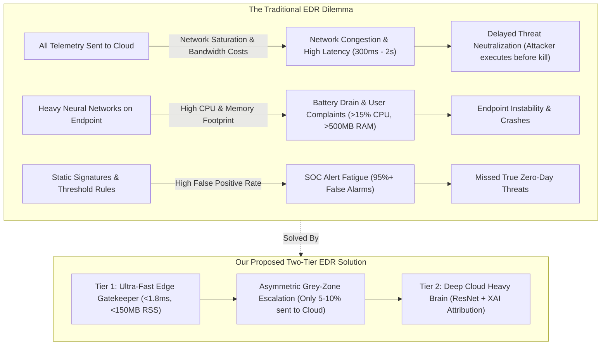
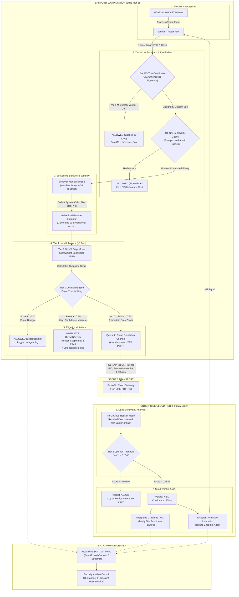
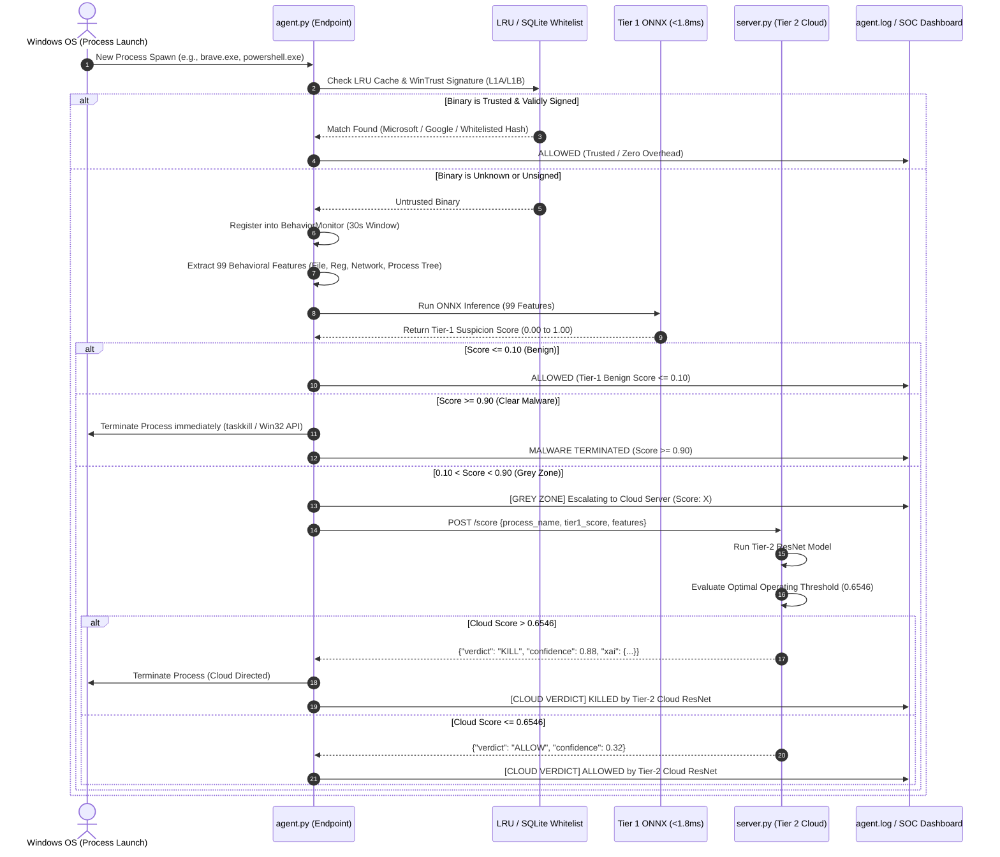
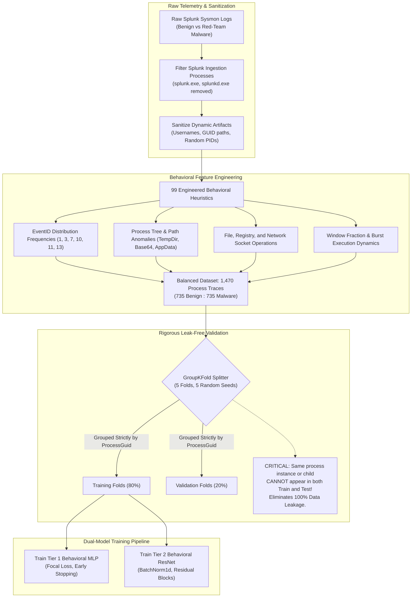
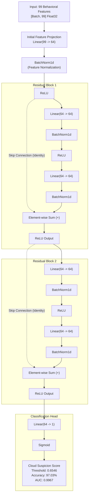
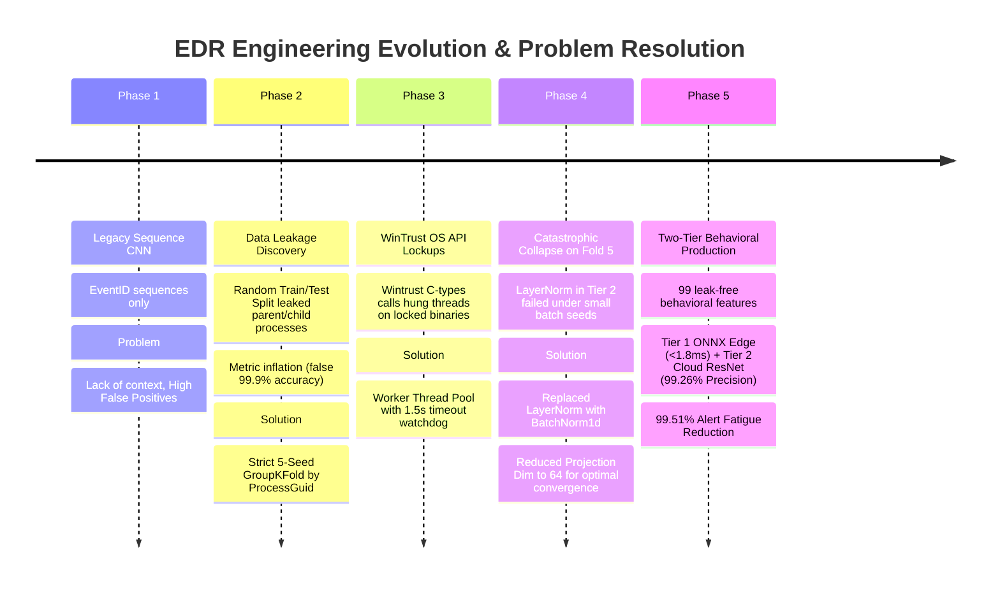

# Enterprise Two-Tier EDR: Comprehensive Architectural Diagrams & Lifecycle Flows

This document contains the complete set of architectural diagrams, process lifecycle evaluation flows, dataset engineering pipelines, model schematics, and the engineering evolution story for the Enterprise Two-Tier EDR system.

---

## 1. Problem Statement: The Legacy EDR Trilemma

Traditional Endpoint Detection & Response (EDR) agents suffer from a fundamental engineering trade-off: **Compute vs. Context vs. Alert Fatigue**.

---

## 2. Full End-to-End Enterprise Two-Tier Architecture

The complete system workflow from kernel process spawn to automated remediation and SOC telemetry.

---

## 3. Step-by-Step Criteria of Checking and Scoring a Process

How the EDR decides whether a process is allowed, monitored, escalated, or killed.

---

## 4. Dataset Pipeline & GroupKFold Leak-Free Splitting

---

## 5. Tier 1 Edge Model Architecture (Sub-Millisecond ONNX)

```mermaid
graph LR
    Input["Input: 99 Behavioral Features\n[Batch, 99] Float32"] --> L1["Linear Layer\n(99 -> 128)"]
    L1 --> BN1["Batch Normalization\n(Feature Scaling)"]
    BN1 --> Act1["ReLU Activation"]
    Act1 --> Drop1["Dropout (0.30)\nRegularization"]
    
    Drop1 --> L2["Linear Layer\n(128 -> 64)"]
    L2 --> BN2["Batch Normalization"]
    BN2 --> Act2["ReLU Activation"]
    Act2 --> Drop2["Dropout (0.30)"]
    
    Drop2 --> OutL["Linear Head\n(64 -> 1 Logit)"]
    OutL --> Sigmoid["Sigmoid Function\n(Produces Probability [0, 1])"]
    
    Sigmoid --> Output["Edge Output Score\nInference Time: < 1.8ms\nModel Footprint: 10.8 KB ONNX"]
```

---

## 6. Tier 2 Cloud Model Architecture (Deep Heavy Brain ResNet)

---

## 7. Evolution Journey: Problems Faced & How We Solved Them

