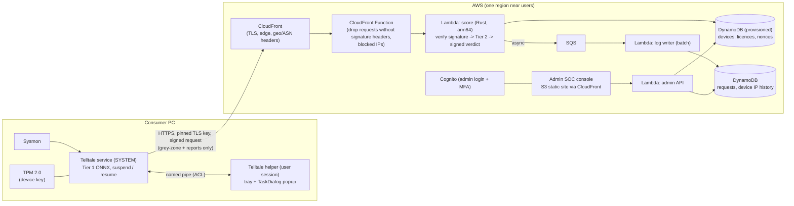
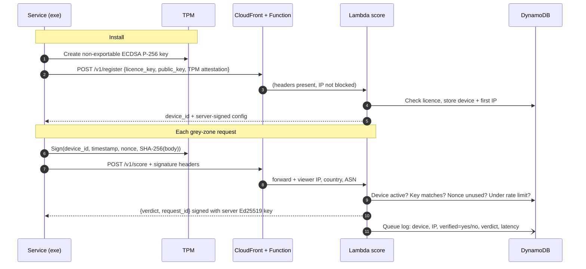
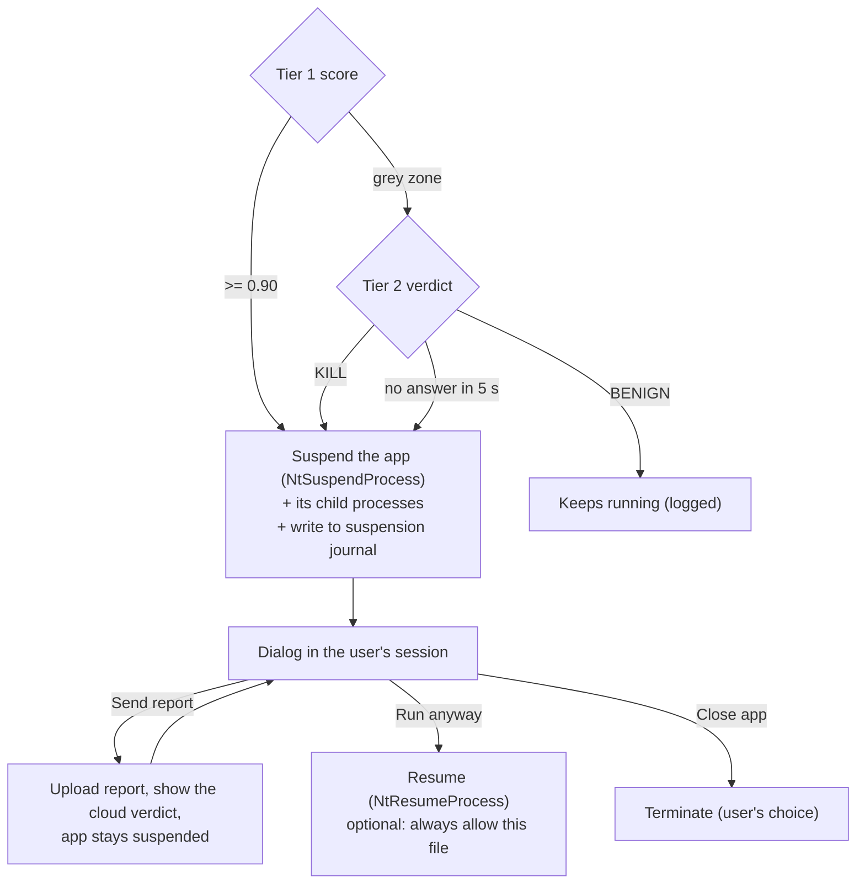

# Telltale for Consumers: Production Architecture Plan

Status: **plan for review, revision 2**, branch `prod`. Baseline before this work: tag `snapshot/pre-prod`.

Goal: ship the agent as a Windows installer for consumers. Tier 2 runs on free cloud services that only
verified installs can call. An admin SOC console shows every device, its IP and every Tier-2 request.
The agent **never kills on its own**: it suspends the app and asks the user.

### What changed in revision 2
- Hosting moved to **free tiers**, primarily on your existing AWS account (section 3).
- **Obfuscation layers** added, so a reverse engineer sees scrambled code and strings (section 4.2).
- Admin page is now a **SOC + admin console** with a device count, device IPs, IP history and abuse
  flags, designed with the ui-ux-pro-max skill (section 6).
- **No silent kills:** threats are suspended and a WinAPI dialog lets the user choose *Send report*,
  *Run anyway* or *Close app* (section 5).
- **Free and open-source certificates** for now (section 7).
- Added: crash-safe suspension journal, budget alarms, privacy and consent, IP blocking (sections 5.5, 8).

---

## 1. Facts that shape the design

| Requirement | Reality | This plan |
|---|---|---|
| Free hosting | AWS always-free covers Lambda (1M requests + 400K GB-s per month) and DynamoDB (25 GB, 25 RCU / 25 WCU, **provisioned mode only**). New-account credit amounts vary; check your account's Free Tier page. | Lambda + DynamoDB (provisioned) + CloudFront + S3 + Cognito. Budget alarm at $1. |
| 2-5 ms response | The model takes ~0.03 ms; the network round trip is usually 10-40 ms for consumers. | Region closest to your users, a warm connection, and a Rust Lambda (< 1 ms of work). Measure, don't promise 5 ms. |
| Reverse engineering can't find or use the endpoint | Code and strings can be scrambled (section 4.2), but the hostname is still visible in network traffic at runtime. | Obfuscation slows attackers down; **TPM-bound device keys** make the endpoint useless to them even once found. |
| Never kill silently | Agreed; it also fits the 2.8% hold-out false-positive rate. | Suspend, then a dialog; the user decides (section 5). |

---

## 2. End-to-end overview (AWS free tier)



Only **essential requests** leave the PC:

| Call | When | Size |
|---|---|---|
| `POST /v1/register` | once, at install | ~1 KB |
| `POST /v1/score` | Tier-1 grey zone only (0.10 < score < 0.90) | ~1 KB |
| `POST /v1/report` | only when the user clicks *Send report* | ~2 KB |
| `GET /v1/config` | about once a day (thresholds, revocations, update notice) | < 1 KB |

---

## 3. Free hosting

### 3.1 Recommended: your AWS account

| Piece | Service | Free allowance (verify on the AWS pricing page) |
|---|---|---|
| Tier-2 API | **Lambda** (Rust on `provided.al2023`, arm64) behind a Function URL | Always free: 1M requests + 400K GB-s per month |
| Edge + TLS | **CloudFront** with Origin Access Control to the Function URL (the Function URL rejects anything not from CloudFront) | Always-free CloudFront allowance (data transfer + requests) |
| Edge filter | **CloudFront Functions** (header check, IP block list) | Free monthly invocation allowance |
| Devices, licences, nonces, logs | **DynamoDB, provisioned mode** (on-demand is *not* free); TTL for nonces (2 min) and logs (90 days) | 25 GB, 25 RCU, 25 WCU |
| Log buffering | **SQS** → batch Lambda, so log writes stay under 25 WCU | 1M requests per month |
| Admin site | **S3** static files via CloudFront | Small storage; CloudFront allowance |
| Admin login | **Cognito** user pool (Lite or Essentials) with MFA | 10,000 MAU free, no expiry |
| Secrets (response-signing key) | **SSM Parameter Store** SecureString (standard tier, AWS-managed key) | Free |
| Cost guard | **AWS Budgets** alarm at $1 and **CloudWatch** alarms on throttles | 2 budgets free |

**Why Rust on Lambda:** a Rust cold start is ~20-50 ms against 500 ms+ for Python with NumPy/PyTorch.
A warm call does the signature check and the 4 matrix multiplies in well under 1 ms. The Tier-2
weights (BatchNorm folded into the Linear layers) are compiled into the binary. A parity test against
PyTorch on all 1,470 dataset rows guards the port, like `edr_sensor/parity_check.py`.

**Rough capacity on the free tier** (an estimate to check against beta data): if a PC escalates
2-8 grey-zone processes a day, 1M requests a month covers about 4,000-16,000 devices.

**Region:** choose the region closest to most users (for example `ap-south-1` Mumbai for India).
Users further away pay the extra round trip.

### 3.2 Other free options

| Option | Free allowance | Good for | Drawback |
|---|---|---|---|
| **Cloudflare Workers Free** | 100,000 requests/day, 10 ms CPU per request, 1,000 requests/min burst | Lowest global latency (runs in the user's city) | Daily cap; a second platform next to AWS |
| **Oracle Cloud Always Free** | Small always-free ARM VMs | A full server you control | You patch and run the VM yourself; single region |
| **Google Cloud Run** | Monthly free request allowance (check current limits) | Containers | Cold starts; another account to manage |

Upgrade path: if users are spread worldwide, put the same Rust scorer on **Cloudflare Workers** (as
WASM) in front of AWS. AWS stays the system of record.

---

## 4. Only a verified exe can use Tier 2

### 4.1 Device verification



1. **TPM device key.** Created through the Microsoft Platform Crypto Provider; it cannot be exported,
   so copying the exe to another PC yields no usable key. PCs without a TPM get a DPAPI-protected
   software key, marked *lower trust* in the console.
2. **Licence key** at registration (one licence = N devices). Revoke a licence or a single device.
3. **Signed requests** with timestamp (±30 s) and single-use nonce: replayed or edited requests fail.
4. **Signed responses.** The agent only accepts verdicts signed by the server key, so a fake server
   can't feed it "allow" answers.
5. **Edge filtering.** The CloudFront Function drops requests without signature headers and anything
   from the IP block list before Lambda runs. That also keeps junk traffic out of the free quota.
6. **Rate limits** per device and per IP (grey-zone traffic is rare, so the limits can be tight).
7. **Model protection.** Responses carry the verdict only, never the raw probability, so copying the
   model by mass querying is slow, visible in the console, and capped by rate limits.

### 4.2 Obfuscation: what a reverse engineer sees

| Layer | Open-source tool | Effect |
|---|---|---|
| Compile Python to native code | **Nuitka** | No `.pyc` bytecode to decompile; agent logic becomes C compiled to machine code |
| Secrets and sensitive logic in Rust | `edr_sensor` (signing, request building, verdict check, endpoint) | The parts that matter live in a compiled, stripped, LTO-optimized module |
| Encrypted strings | **`obfstr`** crate (compile-time string encryption) | The endpoint hostname, paths, header names and the pinned key don't appear in `strings` output |
| Control-flow scrambling (optional) | An LLVM obfuscation pass (e.g. an O-LLVM fork) on the Rust module | Disassembly is much harder to follow |
| TLS certificate pinning | Pinned public key in the Rust client | Interception proxies (Fiddler, mitmproxy) can't read the traffic |
| Self-integrity check | Hash / signature check of its own files at start-up | A patched exe refuses to talk to Tier 2 |

**Honest limit:** obfuscation slows attackers down; it doesn't stop a determined one. At runtime the
hostname is still visible in DNS and the TLS handshake. What protects Tier 2 is section 4.1: without
a registered TPM key, a found endpoint only returns `401`, and every attempt shows up in the console.

---

## 5. Consumer exe: suspend and ask, never kill silently

### 5.1 Flow



- A process is only suspended **after** it has been scored. The agent still never suspends a process
  just to observe it (a frozen process emits no Sysmon events).
- Before suspending, the agent re-checks PID + creation time (PID-reuse guard) and never suspends
  critical OS processes or protected (PPL) processes.
- Children the app spawned during its window (same `ParentProcessGuid` chain) are suspended with it.

### 5.2 Why a helper process

The service runs as SYSTEM in session 0, and Windows does not let session-0 services show windows on
the user's desktop (session 0 isolation). So:

- **Telltale helper** starts in each user session (tray icon). The service sends it the alert over a
  named pipe whose ACL allows only SYSTEM and that user.
- The helper shows the dialog with **`TaskDialogIndirect`** (comctl32 v6), which supports custom button
  labels, an expandable details area, a hyperlink and a checkbox.
- If no helper is running (e.g. it crashed), the service falls back to **`WTSSendMessage`**, a WinAPI
  message box shown in the user's session. It has fixed buttons, so they map to: Yes = Run anyway,
  No = Close app, Cancel = keep suspended.

### 5.3 What the dialog shows

```
┌────────────────────────────────────────────────────────────────┐
│ ⚠  Telltale paused a suspicious app                            │
│                                                                │
│ invoice_2024.pdf.exe                                           │
│ C:\Users\<you>\Downloads\invoice_2024.pdf.exe  (Open location) │
│ Publisher: not signed        Started by: chrome.exe            │
│                                                                │
│ What it tried to do:                                           │
│  • Hid its real type behind a double extension (.pdf.exe)      │
│  • Ran an encoded PowerShell command                           │
│  • Set itself to start with Windows                            │
│  • Connected to an unusual network port (4444)                 │
│                                                                │
│ Verdict: likely malicious (Tier 1 + cloud check)               │
│ ▸ Technical details (PID, scores, time, hash)                  │
│                                                                │
│ [ Send report ]   [ Run anyway ]   [ Close app ]               │
│ ☐ Always allow this file                                       │
└────────────────────────────────────────────────────────────────┘
```

"What it tried to do" is built from the features that were actually set:

| Feature | Plain-language reason |
|---|---|
| `has_double_extension` | Hid its real type behind a double extension (e.g. `.pdf.exe`) |
| `is_executing_from_temp`, `is_from_downloads`, `is_from_appdata` | Runs from a temporary / Downloads / AppData folder |
| `is_system_binary_wrong_path` | Uses a Windows system file name from the wrong folder |
| `has_base64` | Ran an encoded (base64) command |
| `has_powershell_bypass` | Started PowerShell hidden or with security policy bypassed |
| `has_http_download` | Downloaded something from the internet in its command line |
| `has_ps_obfuscation` | Ran an obfuscated PowerShell expression |
| `has_persistence_cmd`, `reg_runkey_log > 0` | Set itself to start with Windows (Run key, scheduled task or service) |
| `has_destructive_cmd` | Ran a command that deletes backups, shadow copies or event logs |
| `file_exec_drops_log > 0` | Created new program or script files |
| `net_has_susp_port` | Connected to an unusual network port |
| `office_spawns_exec`, `browser_spawns_exec` | Was started by Office or a browser |
| `frac_burst_50ms` high | Performed many actions in a very short burst |

### 5.4 The three buttons

| Button | Effect |
|---|---|
| **Send report** | Uploads the report: features, app name, path, SHA-256, Tier scores and the user's comment if any. Sent only with consent, given once at install. The app **stays suspended**; the dialog updates with the cloud verdict and waits for *Run anyway* or *Close app*. |
| **Run anyway** | Resumes the app. With *Always allow this file* ticked, its SHA-256 goes into a per-user allow-list (removable in settings). |
| **Close app** | Terminates the app and its suspended children. This is a user decision, never automatic. Moving the file to quarantine can come later. |

### 5.5 Safety rules for suspension
- **Suspension journal.** Every suspended PID (plus its creation time) is written to disk. If the service
  or helper restarts, it re-shows the dialog. On uninstall, every suspended process is resumed.
- **Never auto-closes on timeout.** The app stays suspended until the user answers. A reminder toast
  appears every 10 minutes, and multiple alerts queue one at a time.
- **The user is locked out of nothing:** the tray menu lists suspended apps with Run / Close actions.
- Tier-2 offline: the agent suspends and asks, labelled "cloud check unavailable".

### 5.6 Packaging

| Piece | Plan |
|---|---|
| Build | Nuitka (standalone) for the service and helper; `edr_sensor` built with `--release`, stripped |
| Service | Windows service (LocalSystem, auto-start), replacing the scheduled task |
| Installer | Inno Setup or WiX (both open source), signed (section 7). Downloads Sysmon from Microsoft at install time (the Sysinternals licence doesn't allow bundling it). |
| Updates | Signed update manifest checked before applying the agent or model updates |
| Privacy | Consent screen: what is sent (features, app name and path, hash, IP), retention, how to delete |

---

## 6. Admin SOC console

### 6.1 What it shows

| View | Contents |
|---|---|
| **Overview (KPIs)** | Total devices, online (seen in 24 h), new today, revoked, lower-trust (no TPM); Tier-2 requests per minute; verdict mix; rejected requests; p50 / p99 latency |
| **Devices** | Device ID, owner / licence, key type (TPM or software), **current IP**, country, ASN / ISP, first seen, last seen, requests (24 h), status; revoke / restore |
| **Device detail** | **IP history** (every IP with first and last seen), request timeline, reports sent, suspicious-activity flags |
| **IP view** | Each IP with the **number of devices** behind it, request count and failures; *block IP* (pushed to the CloudFront Function list) |
| **Live Tier-2 log** | Time, request ID, device, IP, **verified** (TPM / software / failed), process name, Tier-1 score, verdict, latency |
| **Rejected requests** | Bad signature, replay, revoked device, rate-limited, blocked IP, with source IP / ASN |
| **Reports** | Reports sent from user dialogs (app, path, hash, reasons, user decision) |
| **Licences** | Seats used, devices per licence, revoke |
| **Audit log** | Every admin action (who revoked what, when) |

**Automatic abuse flags:**
- many devices registering from one IP,
- one licence on more devices than allowed,
- a device's country or ASN changing often,
- request volume far above normal,
- repeated signature failures from one IP,
- feature vectors that look synthetic (the model-copying pattern).

The IP comes from CloudFront's viewer headers (address, country, ASN). IPs are personal data under
GDPR and India's DPDP Act, so they go in the privacy notice and are kept for 90 days.

### 6.2 Design system (from ui-ux-pro-max)

Generated with the skill (`--design-system`, density 9, motion 2, variance 3, then narrower color /
style / chart searches). Results used: style **`data-dense-dashboard`**, palette **Cybersecurity
Platform**, type pairing **Fira Code + Fira Sans** (tagged "dashboard, data, analytics, admin panels").
The first broad search returned a light "Enterprise Gateway" landing-page pattern, which doesn't fit a
SOC console, so only its typography was kept.

**Color tokens (dark):**

| Token | Hex | Use |
|---|---|---|
| `--color-background` | `#000000` | Page |
| `--color-card` | `#0C130E` | Panels, table body |
| `--color-muted` | `#181818` | Table header, inputs |
| `--color-border` | `#1F1F1F` | Dividers |
| `--color-foreground` | `#E0E0E0` | Body text |
| `--color-muted-foreground` | `#94A3B8` | Secondary text, timestamps |
| `--color-primary` | `#00FF41` | Live / OK status, focus ring (sparingly, never as large fills) |
| `--color-accent` | `#FF3333` | Critical alerts |
| `--color-destructive` | `#EF4444` | Revoke / block buttons |
| `--color-warning` | `#D97706` | Grey zone, lower-trust devices |

**Typography:** Fira Code for headings, numbers, IDs, IPs and hashes (tabular, monospaced); Fira Sans
for body text. 14 px base in tables, 12 px minimum anywhere.

**Layout (data-dense dashboard):** 12-column grid, 8 px gap, 12 px card padding, 36 px table rows,
240 px left sidebar, 56 px header, sticky table headers, sortable and filterable tables, CSV export.

```
┌ Telltale SOC ───────────────────────────────── search ── admin@ ▾ ┐
│ ▣ Overview │ [Devices 1,284] [Online 1,102] [Req/min 37] [Rejected 4] │
│ ▢ Devices  │ ┌ Tier-2 requests / min (anomalies marked) ┐ ┌ Verdicts ┐│
│ ▢ IPs      │ └──────────────────────────────────────────┘ └──────────┘│
│ ▢ Live log │ ┌ Live Tier-2 log ─────────────────────────────────────┐│
│ ▢ Rejected │ │ time  device  IP  verified  process  T1  verdict  ms ││
│ ▢ Reports  │ └──────────────────────────────────────────────────────┘│
│ ▢ Licences │ ┌ Abuse flags ┐ ┌ Top IPs by device count ┐              │
│ ▢ Audit    │ └─────────────┘ └─────────────────────────┘              │
└────────────┴──────────────────────────────────────────────────────────┘
```

**Charts:** requests per minute as a *line chart with highlighted anomalies* (anomaly points get a
distinct shape and a text label, not just color), with an anomaly list next to it as the accessible
fallback. Live counters update at most once a second with a pause control.

**Rules from the skill's checklist:**
- Status is never shown by color alone: every badge has an icon and a text label (e.g. "✓ Verified (TPM)").
- Contrast ≥ 4.5:1 and visible focus rings.
- `prefers-reduced-motion` respected.
- SVG icons (Lucide), no emoji.
- Filters on every table.
- Loading states, and a confirmation step on revoke and block.

**Stack:** a static single-page app (React + Vite + Tailwind + Lucide) on S3 / CloudFront, calling the
admin Lambda with the Cognito token. A decision for you if you prefer another stack.

---

## 7. Certificates: free and open source for now

| Need | Now (free) | Later |
|---|---|---|
| HTTPS for the API and console | The default `*.cloudfront.net` certificate, or **AWS Certificate Manager** for your own domain (free) | — |
| Code signing (exe, installer) | **Self-signed** certificate made with OpenSSL, signed with **osslsigncode** (open source). For you and testers only: Windows shows "Unknown publisher" and SmartScreen warns. | **SignPath Foundation** signs open-source projects for free (needs a public OSI-licensed repo and automated CI builds; the signer shows as "SignPath Foundation"), or a paid OV / EV certificate |
| Device identity | TPM keys (no certificate authority needed) | Optional TPM key attestation check against Microsoft's root |
| Server response signing | Ed25519 key in SSM Parameter Store (free) | Rotation every 90 days |

Note: until the exe is properly signed, Microsoft Defender may flag it, since it suspends and closes
other processes. Plan beta testing around that.

---

## 8. Also added

- **Cost guard:** AWS Budgets alarm at $1; CloudWatch alarm on DynamoDB throttling and Lambda errors.
  Free-tier limits are enforced by design: provisioned DynamoDB, SQS batching, edge filtering.
- **Kill switch / config:** `/v1/config` can lower thresholds, disable cloud calls or push a block list
  without shipping a new exe.
- **Local event log:** every decision (suspended, user choice, reasons) goes to the Windows Event Log
  for the user's own record.
- **Self-protection:** the service resumes everything it suspended if it is being uninstalled or stopped.
- **Telemetry minimisation:** no usernames, no file contents; paths are shown only in reports the user
  chooses to send.

---

## 9. Decisions for you

1. **Region** for the AWS stack (where most users are).
2. **Licensing:** free sign-up, paid keys, or both.
3. **Send report:** the plan keeps the app suspended after sending. Should *Send report* also auto-close
   the app when the cloud says malicious?
4. **Admin stack:** React + Vite + Tailwind (recommended) or plain HTML + Tailwind.
5. **Open-source licence plan:** SignPath's free signing needs a public OSI-licensed repo. Is the
   agent going to stay public (it is MIT today)?
6. **Retention:** 90 days for request logs and IPs, 30 days for features without consent (proposed).

---

## 10. Build order

1. **Tier-2 Lambda (Rust):** BatchNorm-folded weight export, forward pass, parity test, `/v1/score`
   without auth, deploy behind CloudFront, measure latency from your region.
2. **Device identity:** TPM key and signing in `edr_sensor`, `/v1/register`, signature + nonce +
   rate-limit checks, signed responses, CloudFront Function filter.
3. **Suspend and ask:** suspend / resume in `edr_sensor`, suspension journal, the helper with
   `TaskDialogIndirect`, the named pipe, the `WTSSendMessage` fallback, the reason mapping, `/v1/report`.
4. **Admin SOC console:** SQS → log writer, admin API, the views in 6.1, Cognito with MFA, IP blocking.
5. **Obfuscation and packaging:** `obfstr`, TLS pinning, Nuitka builds, Windows service, Inno / WiX
   installer, self-signed signing, signed updates.
6. **Hardening and beta:** replay / stolen-key / synthetic-vector tests, load test within free limits,
   privacy notice, beta group.
