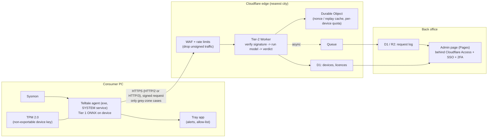
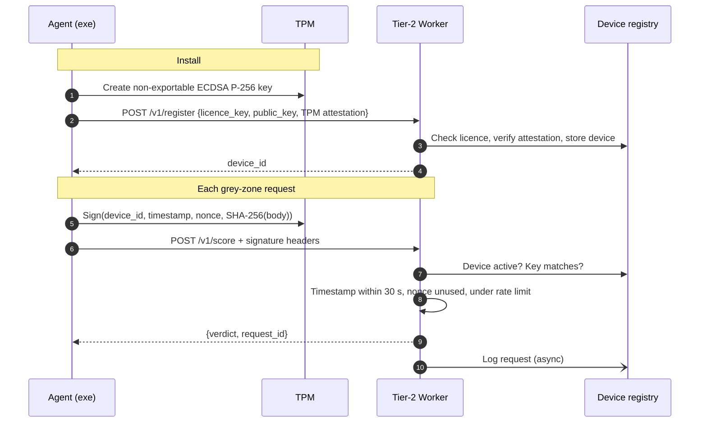

# Telltale for Consumers: Production Architecture Plan

Status: **plan for review**, branch `prod`. Baseline before this work is tagged `snapshot/pre-prod`.

Goal: ship the agent as a signed Windows installer to consumers. Tier 2 runs as a hosted service that
only verified installs can call, with an admin page that shows every Tier-2 request.

---

## 1. Facts that shape the design

| Requirement as asked | What is actually possible | What this plan does |
|---|---|---|
| Host Tier 2 "on Claude" | Claude / the Anthropic API runs Claude models only. It cannot host your PyTorch model. | Host Tier 2 on an edge platform (Cloudflare Workers recommended, section 3). |
| 2-3 ms response, 5 ms max | The model itself takes ~0.03 ms. The network is the problem: a consumer's round trip to the *nearest* data centre is usually 10-40 ms (Wi-Fi + ISP). 2-5 ms only happens on fibre in the same city as a server. | Run Tier 2 *in* the edge location nearest each user (no origin hop) and keep the connection open. Server time < 1 ms; end-to-end is then one network round trip, the lowest possible. |
| Nobody who reverse-engineers the exe finds the endpoint | Impossible. Any program that talks to a server reveals the hostname (DNS, TLS SNI, a packet capture), and a Python exe can be unpacked. | Make the endpoint **useless without a valid device key**: TPM-bound per-install keys, signed requests, replay protection, rate limits and revocation. Knowing the URL gets an attacker nothing. |

**Latency does not limit protection.** A process reaches Tier 2 only after the agent has watched it
for seconds (at least 3 Sysmon events, up to a 30 s window). Whether the verdict then takes 5 ms or
40 ms changes nothing about how much damage is stopped. A realistic target:

- Tier-2 compute: < 1 ms (p99)
- End-to-end, warm connection: p50 < 20 ms, p99 < 100 ms on typical consumer connections
- Offline or timeout: the existing fail-open / fail-closed policy

If you need a hard ≤ 5 ms everywhere, the only way is to ship Tier 2 inside the exe (encrypted). That
trades model secrecy for latency. Section 7 lists it as a decision for you.

---

## 2. End-to-end overview

Only **essential requests** leave the PC:
1. `POST /v1/register` once at install (licence key + device public key).
2. `POST /v1/score` only for Tier-1 grey-zone processes (0.10 < score < 0.90).
3. `GET /v1/config` about once a day (thresholds, revocation, update notice).

---

## 3. Tier 2 hosting (recommended: Cloudflare Workers)

The Tier-2 model is small: ~23.7K parameters and 110 KB on disk. It doesn't need a GPU, a container or
a VM.

- **Model in the Worker.** Fold each BatchNorm into its Linear layer and export the weights to a
  binary blob that ships inside the Worker bundle, not as a public asset. The forward pass is
  4 matrix multiplies and is written in plain TypeScript (no ONNX runtime needed). A parity test,
  like `edr_sensor/parity_check.py`, checks Worker output against PyTorch on all 1,470 dataset rows.
- **No origin server.** The Worker is the whole API, running in 300+ cities. There's no origin IP to
  find and attack, and no extra hop.
- **Warm connections.** The agent keeps one HTTP/2 connection open (keep-alive), so a request costs one
  round trip instead of a TCP+TLS handshake each time.
- **Response is minimal.** It returns `{verdict, request_id}` and optionally a coarse score bucket. It never
  returns the raw probability, which makes it harder to copy the model by querying it many times.

Alternatives, if you prefer another provider:

| Option | Latency | Ops effort | Notes |
|---|---|---|---|
| **Cloudflare Workers** (recommended) | Lowest (runs in the user's city) | Low | Auth, rate limits, queues and the admin page all on one platform |
| AWS: Global Accelerator → NLB → ECS Fargate in 3-4 regions | Low-medium | High | More control; you run and patch the containers |
| Fly.io machines in many regions | Low-medium | Medium | Simple deploys, fewer built-in security features |
| AWS Lambda / Cloud Run | Medium (cold starts) | Low | Cold starts add 100 ms+ to the first request |

---

## 4. Making only a verified exe able to call Tier 2

There is no way to prove from a server which binary sent a request. What can be proved is *which
registered install* sent it, using a key that can't be copied off that PC.

Layers:
1. **Device key in the TPM.** The key is created through the Microsoft Platform Crypto Provider and
   can't be exported, so copying the exe or its files to another PC gives no usable key. On PCs
   without a TPM, fall back to a DPAPI-protected software key, flagged as *lower trust* in the admin page.
2. **Licence key at registration.** One licence = N devices. You can revoke a licence or a single device.
3. **Signed requests.** Each request carries a signature over the device ID, a timestamp, a single-use
   nonce and the body hash. A replayed or modified request fails.
4. **Edge filtering.** WAF rules drop requests without signature headers before they reach the
   Worker. Per-device and per-IP rate limits apply (grey-zone traffic is rare, so the limits can be tight).
5. **Abuse detection.** Flag devices with unusual request volume or feature vectors that look synthetic
   (the model-copying pattern), then review or auto-revoke them from the admin page.
6. **Code signing.** Sign the exe and installer (Authenticode). This doesn't secure the API, but without
   it SmartScreen blocks the installer and antivirus tools flag a program that kills processes.

Signing lives in the Rust `edr_sensor` extension (Windows CNG via the `windows` crate), not in Python.
A Python exe is easy to unpack; the private key never leaves the TPM either way.

---

## 5. Admin page

Hosted on Cloudflare Pages behind Cloudflare Access (SSO + 2FA, admin emails only). It reads from D1.

| View | Shows |
|---|---|
| **Live requests** | Time, request ID, device, licence or owner, **verified status** (TPM / software key / failed), process name, Tier-1 score, verdict, latency, country |
| **Rejected requests** | Bad signature, replay, revoked device, rate-limited, with source IP / ASN |
| **Devices** | Registration date, last seen, key type, request counts, revoke / restore buttons |
| **Licences** | Seats used, devices per licence, revoke |
| **Health** | Requests/min, p50/p99 server time, error rate, verdict mix |

Retention: request metadata 90 days. Feature vectors are stored only with user consent (for retraining)
and deleted after 30 days otherwise.

---

## 6. The consumer exe

| Piece | Plan |
|---|---|
| Packaging | **Nuitka** (compiles Python to C; smaller and harder to unpack than PyInstaller) bundling `agent.py`, `edr_sensor` (.pyd), onnxruntime and `tier1_behavioral.onnx` |
| Runs as | A Windows service (LocalSystem), started at boot. It replaces the current scheduled task. |
| UI | A small tray app for notifications ("Telltale blocked X / flagged X"), allow-listing a program, and pause and settings |
| Installer | MSI (WiX) or Inno Setup, code-signed. Downloads Sysmon from Microsoft at install time. The Sysinternals licence does not allow you to redistribute Sysmon inside your installer. |
| Default mode | **Alert + notify.** The hold-out false-positive rate (2.8%) is too high to kill silently on consumer PCs. Killing is opt-in per user, or on only for very high scores. |
| Updates | Signed auto-update (manifest + signature check) for the agent and models |
| Privacy | Only the 99 numeric features, the process name and the Tier-1 score are sent. No file contents, no usernames. Needs a privacy policy and consent at install. |

---

## 7. Decisions for you

1. **Cloud provider:** Cloudflare Workers (recommended) or AWS / other.
2. **Latency vs secrecy:** keep Tier 2 server-side (typical 10-40 ms), or also ship an encrypted copy
   on the device for a guaranteed ≤ 5 ms with the server as a check.
3. **Licensing:** free with sign-up, paid keys, or both. This decides how registration works.
4. **Consumer kill policy:** alert-only, kill above a high score, or user opt-in.
5. **Code-signing certificate:** an OV or EV certificate has to be bought (EV builds SmartScreen
   reputation faster).
6. **Data retention and consent** for feature vectors used in retraining.

---

## 8. Build order (after your decisions)

1. **Tier-2 Worker:** BN-folded weight export, TypeScript forward pass, parity test, `/v1/score`
   without auth, latency measurement from several regions.
2. **Device identity:** TPM key and signing in `edr_sensor`, `/v1/register`, signature + nonce +
   rate-limit checks in the Worker.
3. **Agent changes:** device keys, signed requests, keep-alive client, `/v1/config`, service mode.
4. **Admin page:** request log via Queue → D1, the views in section 5, Cloudflare Access.
5. **Exe and installer:** Nuitka build, service, tray app, WiX or Inno installer, code signing,
   auto-update.
6. **Hardening and launch:** load test, abuse simulation (replay, stolen config, synthetic vectors),
   privacy policy, beta group.
