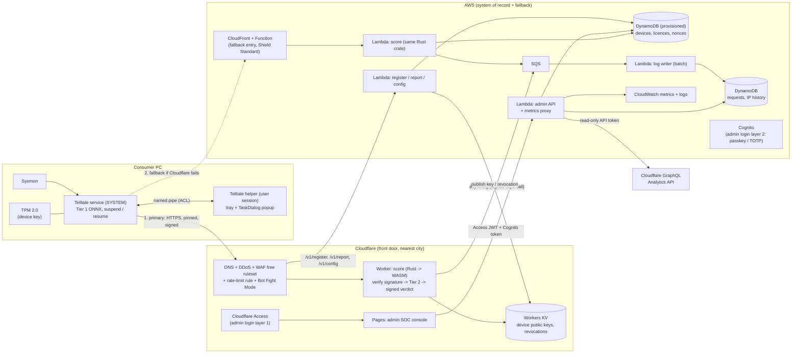
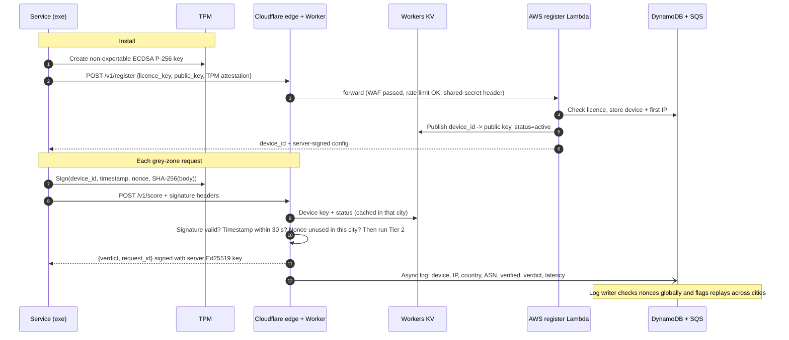
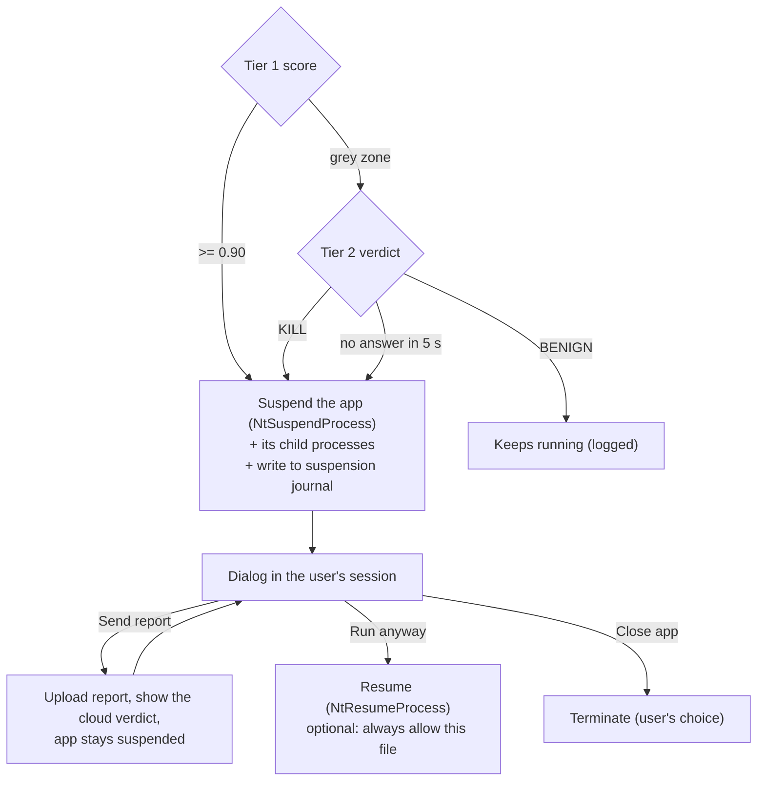
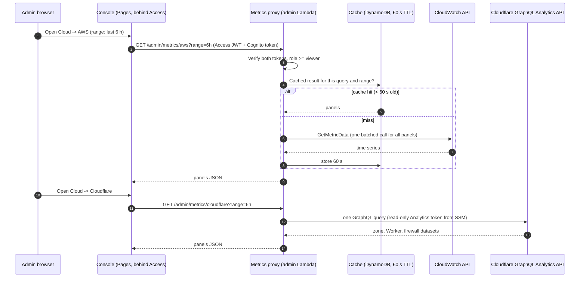
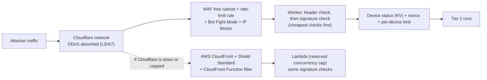

# Telltale for Consumers: Production Architecture Plan

Status: **plan for review, revision 3**, branch `prod`. Baseline before this work: tag `snapshot/pre-prod`.

Goal: ship the agent as a Windows installer for consumers. Tier 2 runs on free Cloudflare and AWS
services that only verified installs can call. An admin SOC console shows every device, its IP, every
Tier-2 request, and the logs and metrics of both clouds. The agent **never kills on its own**: it
suspends the app and asks the user.

### What changed in revision 3
- **Cloudflare and AWS together:** Cloudflare is the front door (DNS, DDoS, WAF, edge scorer,
  admin login), and AWS is the system of record plus an independent fallback scorer (sections 2-3).
- **Cloud observability pages** in the SOC console: a dedicated **AWS** page and **Cloudflare** page
  with Grafana-style charts and log views, fed through a read-only metrics proxy. An optional
  Grafana + Prometheus stack is included (section 6.3).
- **Strong admin login:** Cloudflare Access at the edge, then Cognito with passkeys or TOTP, roles,
  step-up re-authentication and short sessions (section 6.4).
- **Attack resistance:** a threat-by-threat table covering DDoS, floods, quota exhaustion, credential
  attacks, replay, model theft, XSS from device data and more (section 7).
- **certbot and other open-source TLS** where managed certificates don't reach (section 8).

### Revision 2 (kept)
- Hosting moved to **free tiers**, primarily on your existing AWS account (section 3).
- **Obfuscation layers** added, so a reverse engineer sees scrambled code and strings (section 4.2).
- Admin page is now a **SOC + admin console** with a device count, device IPs, IP history and abuse
  flags, designed with the ui-ux-pro-max skill (section 6).
- **No silent kills:** threats are suspended and a WinAPI dialog lets the user choose *Send report*,
  *Run anyway* or *Close app* (section 5).
- **Free and open-source certificates** for now (now section 8).
- Added: crash-safe suspension journal, budget alarms, privacy and consent, IP blocking (sections 5.5, 8).

---

## 1. Facts that shape the design

| Requirement | Reality | This plan |
|---|---|---|
| Free hosting | Cloudflare Free (Workers 100K requests/day, unmetered DDoS, free WAF ruleset, 1 rate-limit rule, Zero Trust up to 50 users) plus AWS always-free (Lambda 1M requests/month, DynamoDB 25 GB provisioned). | Everything below fits those allowances. **The one paid item is a domain name** (~$10/year, at cost through Cloudflare Registrar): WAF, rate limiting and Access need a Cloudflare zone, which `workers.dev` doesn't give. |
| 2-5 ms response | The model takes ~0.03 ms; the network round trip is usually 10-40 ms for consumers. | The scorer runs in the Cloudflare city nearest each user, over a warm connection, with < 1 ms of work. Measure, don't promise 5 ms. |
| "DDoS and every attack proof" | No internet service is proof against every attack. What you can do is put every request behind layers that absorb or reject attacks cheaply, and fail safely when a layer is overwhelmed. | Cloudflare absorbs volumetric attacks; every layer rejects bad traffic before it costs anything; AWS is an independent fallback; the agent fails safe (suspend and ask) when no cloud answers (section 7). |
| Reverse engineering can't find or use the endpoint | Code and strings can be scrambled (section 4.2), but the hostname is still visible in network traffic at runtime. | Obfuscation slows attackers down; **TPM-bound device keys** make the endpoint useless to them even once found. |
| Never kill silently | Agreed; it also fits the 2.8% hold-out false-positive rate. | Suspend, then a dialog; the user decides (section 5). |

---

## 2. End-to-end overview (Cloudflare + AWS)



**Who does what:**
- **Cloudflare** takes all public traffic. It absorbs DDoS, filters with WAF and rate limits, runs the
  scorer next to the user, and gates the admin console behind Access.
- **AWS** owns the data (devices, licences, request logs), handles registration, reports and config,
  serves the admin API, and runs a **separate fallback scorer** so a Cloudflare outage or quota cap
  doesn't stop protection.
- Both scorers are built from **one Rust crate**: Lambda gets it native, the Worker gets it as WASM.
  One parity test covers both.

Only **essential requests** leave the PC:

| Call | When | Size |
|---|---|---|
| `POST /v1/register` | once, at install | ~1 KB |
| `POST /v1/score` | Tier-1 grey zone only (0.10 < score < 0.90) | ~1 KB |
| `POST /v1/report` | only when the user clicks *Send report* | ~2 KB |
| `GET /v1/config` | about once a day (thresholds, revocations, update notice) | < 1 KB |

---

## 3. Free hosting

All allowances below are from the providers' pricing pages at the time of writing. **Verify them
before launch**; free tiers change.

### 3.1 Cloudflare (front door)

| Piece | Service | Free allowance |
|---|---|---|
| DNS, TLS, DDoS | Proxied DNS on your domain, Universal SSL | Unmetered DDoS mitigation on every plan |
| Filtering | **WAF Free Managed Ruleset**, **1 rate-limiting rule**, Bot Fight Mode, Under Attack mode toggle | Included in Free |
| Primary scorer | **Worker** running the Rust scorer compiled to WASM | 100,000 requests/day, 10 ms CPU per request, 1,000 requests/min burst |
| Device keys | **Workers KV**: device public key + status, written by AWS on register / revoke | Free daily read / write allowance (reads cached at each city) |
| Admin console hosting | **Pages** (static site) | Free |
| Admin login layer 1 | **Zero Trust Access** in front of the console and admin API hostnames | Up to 50 users free |

### 3.2 AWS (system of record + fallback)

| Piece | Service | Free allowance |
|---|---|---|
| Fallback scorer | **Lambda** (same Rust crate, native arm64) behind **CloudFront** with Origin Access Control | Lambda: 1M requests + 400K GB-s per month, always free; CloudFront always-free allowance |
| Fallback edge filter | **CloudFront Functions** (header check, IP block list) + **Shield Standard** (automatic) | Free |
| Register / report / config | Lambda, reached **only through Cloudflare** (checks a Cloudflare-to-AWS shared secret header and the device signature) | Lambda allowance |
| Data | **DynamoDB, provisioned mode** (on-demand is *not* free): devices, licences, nonces (TTL 2 min), request logs and IP history (TTL 90 days) | 25 GB, 25 RCU, 25 WCU |
| Log buffering | **SQS** → batch Lambda, so writes stay under 25 WCU. The Worker sends with a signed SQS call restricted to `sqs:SendMessage`. | 1M requests per month |
| Admin API + metrics proxy | Lambda, reached only through Cloudflare Access | Lambda allowance |
| Admin login layer 2 | **Cognito** user pool (Essentials: passkeys + TOTP) | 10,000 MAU free, no expiry |
| Secrets | **SSM Parameter Store** SecureString (response-signing key, Cloudflare API tokens) | Free (standard tier) |
| Metrics + logs | **CloudWatch** (built-in metrics, Lambda logs) | Free allowance for metrics, API calls and log ingestion; check current limits |
| Cost guard | **AWS Budgets** alarm at $1; Lambda **reserved concurrency** caps | 2 budgets free |

### 3.3 Failover and capacity

- The agent carries **two endpoints**, both obfuscated and certificate-pinned:
  1. `api.<your-domain>` (Cloudflare Worker),
  2. the AWS CloudFront address.
  It uses the first. On a timeout, a 5xx, or Cloudflare's free-plan daily cap (error 1027), it
  switches to the second for 10 minutes.
- Both scorers verify the same TPM signatures and return the same signed verdicts.
- **Capacity on free plans** (an estimate to check against beta data), if a PC escalates 2-8
  grey-zone processes a day:
  - Cloudflare's 100K/day covers about 12,000-50,000 devices.
  - AWS's 1M/month as fallback covers about 4,000-16,000 devices on its own.
- **Why Rust:** cold start ~20-50 ms on Lambda against 500 ms+ for Python with PyTorch. Workers have
  no cold start to speak of. A warm call does the signature check and the 4 matrix multiplies in well
  under 1 ms. The weights (BatchNorm folded into Linear) are compiled in. A parity test against
  PyTorch on all 1,470 dataset rows guards both builds.
- **AWS region:** closest to most users (e.g. `ap-south-1` Mumbai for India). Cloudflare needs no
  region choice.

---

## 4. Only a verified exe can use Tier 2

### 4.1 Device verification



1. **TPM device key.** Created through the Microsoft Platform Crypto Provider; it cannot be exported,
   so copying the exe to another PC yields no usable key. PCs without a TPM get a DPAPI-protected
   software key, marked *lower trust* in the console.
2. **Licence key** at registration (one licence = N devices). Revoke a licence or a single device.
3. **Signed requests** with timestamp (±30 s) and single-use nonce: replayed or edited requests fail.
4. **Signed responses.** The agent only accepts verdicts signed by the server key, so a fake server
   can't feed it "allow" answers.
5. **Edge filtering.** Cloudflare's WAF rule drops requests without signature headers and anything from
   the IP block list before the Worker runs, so junk traffic never reaches the free quota. On the AWS
   fallback path, a CloudFront Function does the same.
6. **Rate limits** per IP at the edge (Cloudflare's one free rule, on `/v1/*`), and per device in the
   scorer. Grey-zone traffic is rare, so the limits can be tight.
7. **Revocation is fast.** Revoking a device writes `status=revoked` to KV, which reaches every city
   within about a minute. The agent's daily `/v1/config` also carries the revocation list.
8. **Model protection.** Responses carry the verdict only, never the raw probability, so copying the
   model by mass querying is slow, visible in the console, and capped by rate limits.

### 4.2 Obfuscation: what a reverse engineer sees

| Layer | Open-source tool | Effect |
|---|---|---|
| Compile Python to native code | **Nuitka** | No `.pyc` bytecode to decompile; agent logic becomes C compiled to machine code |
| Secrets and sensitive logic in Rust | `edr_sensor` (signing, request building, verdict check, endpoint) | The parts that matter live in a compiled, stripped, LTO-optimized module |
| Encrypted strings | **`obfstr`** crate (compile-time string encryption) | The endpoint hostname, paths, header names and the pinned key don't appear in `strings` output |
| Control-flow scrambling (optional) | An LLVM obfuscation pass (e.g. an O-LLVM fork) on the Rust module | Disassembly is much harder to follow |
| TLS certificate pinning | Pinned public key in the Rust client | Interception proxies (Fiddler, mitmproxy) can't read the traffic |
| Self-integrity check | Hash / signature check of its own files at start-up | A patched exe refuses to talk to Tier 2 |

**Honest limit:** obfuscation slows attackers down; it doesn't stop a determined one. At runtime the
hostname is still visible in DNS and the TLS handshake. What protects Tier 2 is section 4.1: without
a registered TPM key, a found endpoint only returns `401`, and every attempt shows up in the console.

---

## 5. Consumer exe: suspend and ask, never kill silently

### 5.1 Flow



- A process is only suspended **after** it has been scored. The agent still never suspends a process
  just to observe it (a frozen process emits no Sysmon events).
- Before suspending, the agent re-checks PID + creation time (PID-reuse guard) and never suspends
  critical OS processes or protected (PPL) processes.
- Children the app spawned during its window (same `ParentProcessGuid` chain) are suspended with it.

### 5.2 Why a helper process

The service runs as SYSTEM in session 0, and Windows does not let session-0 services show windows on
the user's desktop (session 0 isolation). So:

- **Telltale helper** starts in each user session (tray icon). The service sends it the alert over a
  named pipe whose ACL allows only SYSTEM and that user.
- The helper shows the dialog with **`TaskDialogIndirect`** (comctl32 v6), which supports custom button
  labels, an expandable details area, a hyperlink and a checkbox.
- If no helper is running (e.g. it crashed), the service falls back to **`WTSSendMessage`**, a WinAPI
  message box shown in the user's session. It has fixed buttons, so they map to: Yes = Run anyway,
  No = Close app, Cancel = keep suspended.

### 5.3 What the dialog shows

```
┌────────────────────────────────────────────────────────────────┐
│ ⚠  Telltale paused a suspicious app                            │
│                                                                │
│ invoice_2024.pdf.exe                                           │
│ C:\Users\<you>\Downloads\invoice_2024.pdf.exe  (Open location) │
│ Publisher: not signed        Started by: chrome.exe            │
│                                                                │
│ What it tried to do:                                           │
│  • Hid its real type behind a double extension (.pdf.exe)      │
│  • Ran an encoded PowerShell command                           │
│  • Set itself to start with Windows                            │
│  • Connected to an unusual network port (4444)                 │
│                                                                │
│ Verdict: likely malicious (Tier 1 + cloud check)               │
│ ▸ Technical details (PID, scores, time, hash)                  │
│                                                                │
│ [ Send report ]   [ Run anyway ]   [ Close app ]               │
│ ☐ Always allow this file                                       │
└────────────────────────────────────────────────────────────────┘
```

"What it tried to do" is built from the features that were actually set:

| Feature | Plain-language reason |
|---|---|
| `has_double_extension` | Hid its real type behind a double extension (e.g. `.pdf.exe`) |
| `is_executing_from_temp`, `is_from_downloads`, `is_from_appdata` | Runs from a temporary / Downloads / AppData folder |
| `is_system_binary_wrong_path` | Uses a Windows system file name from the wrong folder |
| `has_base64` | Ran an encoded (base64) command |
| `has_powershell_bypass` | Started PowerShell hidden or with security policy bypassed |
| `has_http_download` | Downloaded something from the internet in its command line |
| `has_ps_obfuscation` | Ran an obfuscated PowerShell expression |
| `has_persistence_cmd`, `reg_runkey_log > 0` | Set itself to start with Windows (Run key, scheduled task or service) |
| `has_destructive_cmd` | Ran a command that deletes backups, shadow copies or event logs |
| `file_exec_drops_log > 0` | Created new program or script files |
| `net_has_susp_port` | Connected to an unusual network port |
| `office_spawns_exec`, `browser_spawns_exec` | Was started by Office or a browser |
| `frac_burst_50ms` high | Performed many actions in a very short burst |

### 5.4 The three buttons

| Button | Effect |
|---|---|
| **Send report** | Uploads the report: features, app name, path, SHA-256, Tier scores and the user's comment if any. Sent only with consent, given once at install. The app **stays suspended**; the dialog updates with the cloud verdict and waits for *Run anyway* or *Close app*. |
| **Run anyway** | Resumes the app. With *Always allow this file* ticked, its SHA-256 goes into a per-user allow-list (removable in settings). |
| **Close app** | Terminates the app and its suspended children. This is a user decision, never automatic. Moving the file to quarantine can come later. |

### 5.5 Safety rules for suspension
- **Suspension journal.** Every suspended PID (plus its creation time) is written to disk. If the service
  or helper restarts, it re-shows the dialog. On uninstall, every suspended process is resumed.
- **Never auto-closes on timeout.** The app stays suspended until the user answers. A reminder toast
  appears every 10 minutes, and multiple alerts queue one at a time.
- **The user is locked out of nothing:** the tray menu lists suspended apps with Run / Close actions.
- Tier-2 offline: the agent suspends and asks, labelled "cloud check unavailable".

### 5.6 Packaging

| Piece | Plan |
|---|---|
| Build | Nuitka (standalone) for the service and helper; `edr_sensor` built with `--release`, stripped |
| Service | Windows service (LocalSystem, auto-start), replacing the scheduled task |
| Installer | Inno Setup or WiX (both open source), signed (section 8). Downloads Sysmon from Microsoft at install time (the Sysinternals licence doesn't allow bundling it). |
| Updates | Signed update manifest checked before applying the agent or model updates |
| Privacy | Consent screen: what is sent (features, app name and path, hash, IP), retention, how to delete |

---

## 6. Admin SOC console

### 6.1 What it shows

| View | Contents |
|---|---|
| **Overview (KPIs)** | Total devices, online (seen in 24 h), new today, revoked, lower-trust (no TPM); Tier-2 requests per minute; verdict mix; rejected requests; p50 / p99 latency |
| **Devices** | Device ID, owner / licence, key type (TPM or software), **current IP**, country, ASN / ISP, first seen, last seen, requests (24 h), status; revoke / restore |
| **Device detail** | **IP history** (every IP with first and last seen), request timeline, reports sent, suspicious-activity flags |
| **IP view** | Each IP with the **number of devices** behind it, request count and failures; *block IP* (pushed to the Cloudflare WAF IP list and the CloudFront Function list) |
| **Cloud → Cloudflare** | Edge traffic, DDoS and WAF events, Worker health, free-quota gauges (section 6.3) |
| **Cloud → AWS** | Lambda, DynamoDB, SQS and CloudFront health, CloudWatch log search, spend (section 6.3) |
| **Live Tier-2 log** | Time, request ID, device, IP, **verified** (TPM / software / failed), process name, Tier-1 score, verdict, latency |
| **Rejected requests** | Bad signature, replay, revoked device, rate-limited, blocked IP, with source IP / ASN |
| **Reports** | Reports sent from user dialogs (app, path, hash, reasons, user decision) |
| **Licences** | Seats used, devices per licence, revoke |
| **Audit log** | Every admin action (who revoked what, when) |

**Automatic abuse flags:**
- many devices registering from one IP,
- one licence on more devices than allowed,
- a device's country or ASN changing often,
- request volume far above normal,
- repeated signature failures from one IP,
- feature vectors that look synthetic (the model-copying pattern).

The IP comes from CloudFront's viewer headers (address, country, ASN). IPs are personal data under
GDPR and India's DPDP Act, so they go in the privacy notice and are kept for 90 days.

### 6.2 Design system (from ui-ux-pro-max)

Generated with the skill (`--design-system`, density 9, motion 2, variance 3, then narrower color /
style / chart searches). Results used: style **`data-dense-dashboard`**, palette **Cybersecurity
Platform**, type pairing **Fira Code + Fira Sans** (tagged "dashboard, data, analytics, admin panels").
The first broad search returned a light "Enterprise Gateway" landing-page pattern, which doesn't fit a
SOC console, so only its typography was kept.

**Color tokens (dark):**

| Token | Hex | Use |
|---|---|---|
| `--color-background` | `#000000` | Page |
| `--color-card` | `#0C130E` | Panels, table body |
| `--color-muted` | `#181818` | Table header, inputs |
| `--color-border` | `#1F1F1F` | Dividers |
| `--color-foreground` | `#E0E0E0` | Body text |
| `--color-muted-foreground` | `#94A3B8` | Secondary text, timestamps |
| `--color-primary` | `#00FF41` | Live / OK status, focus ring (sparingly, never as large fills) |
| `--color-accent` | `#FF3333` | Critical alerts |
| `--color-destructive` | `#EF4444` | Revoke / block buttons |
| `--color-warning` | `#D97706` | Grey zone, lower-trust devices |

**Typography:** Fira Code for headings, numbers, IDs, IPs and hashes (tabular, monospaced); Fira Sans
for body text. 14 px base in tables, 12 px minimum anywhere.

**Layout (data-dense dashboard):** 12-column grid, 8 px gap, 12 px card padding, 36 px table rows,
240 px left sidebar, 56 px header, sticky table headers, sortable and filterable tables, CSV export.

```
┌ Telltale SOC ───────────────────────────────── search ── admin@ ▾ ┐
│ ▣ Overview │ [Devices 1,284] [Online 1,102] [Req/min 37] [Rejected 4] │
│ ▢ Devices  │ ┌ Tier-2 requests / min (anomalies marked) ┐ ┌ Verdicts ┐│
│ ▢ IPs      │ └──────────────────────────────────────────┘ └──────────┘│
│ ▢ Live log │ ┌ Live Tier-2 log ─────────────────────────────────────┐│
│ ▢ Rejected │ │ time  device  IP  verified  process  T1  verdict  ms ││
│ ▢ Reports  │ └──────────────────────────────────────────────────────┘│
│ ▢ Licences │ ┌ Abuse flags ┐ ┌ Top IPs by device count ┐              │
│ ▢ Audit    │ └─────────────┘ └─────────────────────────┘              │
└────────────┴──────────────────────────────────────────────────────────┘
```

**Charts:** requests per minute as a *line chart with highlighted anomalies* (anomaly points get a
distinct shape and a text label, not just color), with an anomaly list next to it as the accessible
fallback. Live counters update at most once a second with a pause control.

**Rules from the skill's checklist:**
- Status is never shown by color alone: every badge has an icon and a text label (e.g. "✓ Verified (TPM)").
- Contrast ≥ 4.5:1 and visible focus rings.
- `prefers-reduced-motion` respected.
- SVG icons (Lucide), no emoji.
- Filters on every table.
- Loading states, and a confirmation step on revoke and block.

**Stack:** a static single-page app (React + Vite + Tailwind + Lucide) on **Cloudflare Pages** behind
Access, calling the admin Lambda. A decision for you if you prefer another stack.

### 6.3 Cloud observability: dedicated AWS and Cloudflare pages

Two pages in the console, laid out like Grafana dashboards (time-range picker, panels, auto-refresh),
using the same design tokens as the rest of the console.

**How the console gets cloud metrics:**



- The browser **never holds a cloud credential**. The proxy uses an IAM role limited to
  `cloudwatch:GetMetricData`, `logs:FilterLogEvents` and `logs:StartQuery`/`GetQueryResults` on the
  Telltale log groups. The Cloudflare token can only read Analytics, with no write scopes.
- **Batched, cached, polled every 60 s**, so even several admins stay far inside the API allowances.
  Live mode on the request log uses the app's own log table, not the cloud APIs.

**Cloud → AWS page:**

| Panel | Source |
|---|---|
| Lambda invocations, errors, throttles, p50 / p99 duration, concurrent executions (per function) | CloudWatch `AWS/Lambda` |
| DynamoDB consumed vs provisioned RCU / WCU, throttled requests (per table) | CloudWatch `AWS/DynamoDB` |
| SQS queue depth and age of oldest message | CloudWatch `AWS/SQS` |
| CloudFront requests, 4xx / 5xx rate (fallback path) | CloudWatch `AWS/CloudFront` |
| **Free-quota gauges:** Lambda requests this month vs 1M, DynamoDB capacity vs 25, SQS vs 1M | Derived from the above |
| **Log search:** filter by function, level, request ID or device ID | CloudWatch Logs (`FilterLogEvents`; Logs Insights for heavier queries) |
| Budget: spend this month vs the $1 alarm | AWS Budgets API |

**Cloud → Cloudflare page:**

| Panel | Source (GraphQL dataset) |
|---|---|
| Edge requests, cached vs uncached, status codes, top countries | `httpRequestsAdaptiveGroups` |
| **Security events:** WAF, rate-limit and Bot Fight blocks, by action, rule, top IPs, top ASNs | `firewallEventsAdaptive` |
| DDoS mitigation events | Security events (DDoS source) |
| Worker requests, errors, CPU time p50 / p99, subrequests | `workersInvocationsAdaptive` |
| **Free-quota gauges:** Worker requests today vs 100K (alert at 80%), KV reads / writes vs daily allowance | Derived |
| Access logins (who, when, from where, allowed / denied) | Access audit logs API |

**Alerts** (console banner + email):
- Worker requests above 80% of the daily cap.
- A spike in WAF blocks.
- Lambda throttles or errors above baseline.
- DynamoDB throttling.
- Budget alarm.
- Access login from a new country.

**Metric naming** follows Prometheus style, e.g. `telltale_score_requests_total{verdict,verified,path}`
and `telltale_score_latency_ms_bucket`. Moving to Prometheus later is then a straight copy.

**Option B, a real Grafana + Prometheus (add when you need custom dashboards or long retention):**

| Choice | Cost | How |
|---|---|---|
| **Grafana Cloud Free** | Free: 10K active series, 50 GB logs, 14-day retention, 3 users (check current limits) | CloudWatch data source built in; Cloudflare via its GraphQL API. Link or embed from the console. |
| **Self-hosted Grafana OSS + Prometheus** | Free on an Oracle Always Free VM | `yet-another-cloudwatch-exporter` for AWS, `cloudflare-exporter` for Cloudflare, Prometheus scraping both. The VM sits behind **Cloudflare Tunnel** (no open inbound ports) and **Access**, with TLS from **certbot** (section 8). |

The built-in pages come first. They cover what an operator needs without another system to secure
and patch.

### 6.4 Strong admin login

Two independent layers, so a stolen password alone, or a bug in one layer, isn't enough.

| Layer | What | Settings |
|---|---|---|
| **1. Cloudflare Access** (edge) | The console and admin API hostnames are unreachable until Access lets you in | Allow-list of admin emails; identity from GitHub or Google with MFA required at the provider (or Access one-time PIN); optional country restriction; session 8 h |
| **2. Cognito** (app) | Login inside the console | **Passkeys (WebAuthn)** preferred, TOTP as backup, no SMS. 14+ character passwords. Lockout after repeated failures. |
| **3. Backend check** | Every admin API call | Lambda verifies **both** the Access JWT (`Cf-Access-Jwt-Assertion` against your team's signing keys) and the Cognito access token. If either is missing or invalid, the call is rejected. |

- **Roles** (Cognito groups): `viewer` (read-only, including cloud pages), `analyst` (also reports and
  flags), `admin` (also revoke, block, licences, rotate keys).
- **Step-up re-authentication:** destructive actions (revoke a device, block an IP, rotate a key,
  delete data) require a fresh passkey or TOTP check within the last 5 minutes.
- **Sessions:** 15 minutes idle, 8 hours absolute, rotating refresh tokens. Tokens are kept in memory,
  not `localStorage`.
- **Browser hardening:** strict Content-Security-Policy (no inline scripts), HSTS, `frame-ancestors
  'none'`, tokens in the Authorization header (no cookie, so no CSRF).
- **Audit:** every login (from Access and Cognito) and every admin action goes to the audit log, with
  an alert on a login from a new country or device.
- **Break-glass:** one offline admin account with a hardware security key, stored securely, for when
  the identity provider is down.

---

## 7. Attack resistance

No internet service is proof against every attack. The design goal: every attack hits a layer that
absorbs or rejects it cheaply, and when a layer is overwhelmed, the system **fails safe**. Users stay
protected because the agent still suspends and asks.



| Threat | Mitigation |
|---|---|
| **Volumetric DDoS** (L3/L4) | Cloudflare's unmetered DDoS mitigation on every plan; on the fallback path, AWS Shield Standard (automatic on CloudFront) |
| **HTTP floods** (L7) | WAF free managed ruleset, a rate-limit rule on `/v1/*`, Bot Fight Mode, and the "Under Attack" switch for emergencies. Requests without signature headers are dropped at the edge before the Worker runs. |
| **Quota exhaustion** (burning the free daily cap) | Edge drops unsigned traffic first, so floods don't count against the Worker quota. Per-device limits in the scorer. At the Cloudflare cap the agent fails over to AWS. Lambda **reserved concurrency** caps how much AWS can be driven. Budget alarm at $1. |
| **"Denial of wallet"** (running up a bill) | Free plans hard-cap rather than bill; AWS reserved concurrency + Budgets alarm; no on-demand DynamoDB |
| **Forged or replayed requests** | TPM signatures, ±30 s timestamps, single-use nonces (checked per city at the edge and globally in the log writer) |
| **Stolen or cloned installs** | Non-exportable TPM keys; abuse flags (many devices per IP, licence over its seat count, jumping countries); one-click revoke |
| **Fake server / man in the middle** | Certificate pinning in the agent; verdicts signed with the server's Ed25519 key |
| **Model theft by mass querying** | Verdict only (no probability), per-device rate limits, synthetic-vector detection |
| **Admin account attacks** (phishing, stuffing, session theft) | Access in front, so the login page isn't public. Phishing-resistant passkeys. Lockout. Step-up re-authentication on destructive actions. Short sessions. |
| **Malicious data from devices** (XSS through a process name or path) | Process names and paths are attacker-controlled: render them as text only, strict CSP, cap field lengths and validate at the API, never build queries from them |
| **Origin bypass** (hitting AWS directly to skip Cloudflare) | Register / report / admin Lambdas require a Cloudflare-only secret header (rotated) and the Access JWT; the fallback scorer sits behind CloudFront with Origin Access Control and does its own signature checks |
| **Leaked cloud credentials** | Least-privilege IAM role per Lambda; scoped Cloudflare API tokens (Analytics read; KV write only for the register Lambda); secrets in SSM; rotation every 90 days |
| **Supply chain** | Pinned dependencies, `cargo audit` and `pip-audit` in CI, GitHub secret scanning, signed builds |
| **Detection and response** | Cloudflare security events and AWS CloudTrail event history (90 days, free) on the cloud pages; alerts on abnormal spikes; runbook: Under Attack mode → block ASN/IP → rotate shared secret → revoke devices |

---

## 8. Certificates and TLS: free and open source

| Need | Now (free) | Later |
|---|---|---|
| HTTPS on public hostnames (`api.`, `admin.`) | **Cloudflare Universal SSL** (automatic); minimum TLS 1.2, HSTS on | — |
| Cloudflare → AWS | AWS's own certificates on CloudFront / Lambda URLs (or **AWS Certificate Manager** for a custom domain, free) | — |
| Any self-hosted server (e.g. Option B Grafana VM) | **certbot** (Let's Encrypt) with the **`certbot-dns-cloudflare`** plugin (DNS-01, so no port 80 needs to be open), auto-renewed by a systemd timer; or a **Cloudflare Origin CA** certificate behind Cloudflare | — |
| Code signing (exe, installer) | **Self-signed** certificate made with OpenSSL, signed with **osslsigncode** (open source). For you and testers only: Windows shows "Unknown publisher" and SmartScreen warns. | **SignPath Foundation** (free for public OSI-licensed repos, automated CI builds; signer shows as "SignPath Foundation"), or a paid OV / EV certificate |
| Device identity | TPM keys (no certificate authority needed) | Optional TPM key attestation check against Microsoft's root |
| Server response signing | Ed25519 key in SSM Parameter Store (free) | Rotation every 90 days |

Use certbot only where managed certificates don't reach. Cloudflare and AWS renew their own
certificates, so there's nothing to maintain there.

Note: until the exe is properly signed, Microsoft Defender may flag it, since it suspends and closes
other processes. Plan beta testing around that.

---

## 9. Also added

- **Cost guard:** AWS Budgets alarm at $1; Cloudflare quota alerts at 80%; CloudWatch alarms on
  DynamoDB throttling and Lambda errors. Free-tier limits are enforced by design: provisioned DynamoDB,
  SQS batching, edge filtering.
- **Kill switch / config:** `/v1/config` can lower thresholds, disable cloud calls, switch the primary
  endpoint or push a block list without shipping a new exe.
- **Infrastructure as code:** Terraform (open source) for both Cloudflare and AWS, so the whole
  stack can be rebuilt or audited from the repo.
- **Local event log:** every decision (suspended, user choice, reasons) goes to the Windows Event Log
  for the user's own record.
- **Self-protection:** the service resumes everything it suspended if it is being uninstalled or stopped.
- **Telemetry minimisation:** no usernames, no file contents; paths are shown only in reports the user
  chooses to send.

---

## 10. Decisions for you

1. **Domain name** to buy (~$10/year; the only paid item). It's needed for WAF, rate limits and Access.
2. **AWS region** for the system of record and fallback (where most users are).
3. **Licensing:** free sign-up, paid keys, or both.
4. **Send report:** the plan keeps the app suspended after sending. Should *Send report* also auto-close
   the app when the cloud says malicious?
5. **Admin identity provider** for Access: GitHub, Google, or Access one-time PIN.
6. **Observability:** built-in pages only (recommended first), or also Grafana Cloud Free / self-hosted
   Grafana + Prometheus.
7. **Admin stack:** React + Vite + Tailwind (recommended) or plain HTML + Tailwind.
8. **Open-source licence plan:** SignPath's free signing needs a public OSI-licensed repo. Is the
   agent going to stay public (it is MIT today)?
9. **Retention:** 90 days for request logs and IPs, 30 days for features without consent (proposed).

---

## 11. Build order

1. **Tier-2 scorer (Rust crate):** BatchNorm-folded weight export, forward pass, parity test. Build it
   for Lambda (native) and the Worker (WASM). Deploy `/v1/score` without auth on both and measure
   latency. *Status: built and parity-checked ([`tier2_scorer/`](../tier2_scorer/README.md),
   [`worker/`](../worker/src/index.js)); deploy waits on the domain, the AWS region and your accounts.*
2. **Device identity:** TPM key and signing in `edr_sensor`, `/v1/register` (AWS, publishing to KV),
   signature + nonce + rate-limit checks in both scorers, signed responses, agent failover between
   endpoints.
3. **Edge protection:** domain on Cloudflare, WAF ruleset, rate-limit rule, Bot Fight Mode,
   unsigned-request drop, CloudFront Function on the fallback path, Cloudflare-only secret on the AWS
   origins.
4. **Suspend and ask:** suspend / resume in `edr_sensor`, suspension journal, the helper with
   `TaskDialogIndirect`, the named pipe, the `WTSSendMessage` fallback, the reason mapping, `/v1/report`.
5. **Admin SOC console:** SQS → log writer, admin API, Access + Cognito (passkeys, roles, step-up), the
   views in 6.1, IP blocking.
6. **Cloud observability:** metrics proxy with caching, AWS and Cloudflare pages, quota gauges, alerts.
7. **Obfuscation and packaging:** `obfstr`, TLS pinning, Nuitka builds, Windows service, Inno / WiX
   installer, self-signed signing, signed updates.
8. **Hardening and beta:** replay / stolen-key / synthetic-vector / flood tests within the free limits,
   origin-bypass test, privacy notice, beta group.
